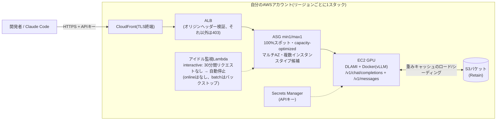

# token-forge

[English](README.md) | [한국어](README.ko.md) | **日本語**

**自分のAWSアカウント内で動くプライベートなバイブコーディングLLM。** オープンウェイトモデルを
**100%スポットインスタンス**で安価にサービングし、常時収集される**公開スポットインテリジェンス
フィード**(プレイスメントスコアの推移)により「どのリージョンでGPUスポットが確保しやすいか」を
データで判断できる。Claude Codeなどのコーディングエージェントがそのまま接続できる
OpenAI・Anthropic互換APIを提供し、プロンプト・レスポンス・利用統計はアカウントの外に出ない。

**検証済みモデルカタログ**(すべて実サービングで検証済み):

| モデル | クラス | インスタンス | 備考 |
|---|---|---|---|
| [Qwen3-Coder-30B](https://huggingface.co/Qwen/Qwen3-Coder-30B-A3B-Instruct-FP8) | 30B MoE | g6e.12xlarge(約$2.6/hスポット) | 推奨デフォルト — コスト例で使う時間単価の基準 |
| [GLM-4.6](https://huggingface.co/zai-org/GLM-4.6-FP8) | 355B MoE | p5.48xlarge | 大規模向けの選択肢 |
| [Solar-Open2-250B](https://huggingface.co/upstage/Solar-Open2-250B) | 250B MoE | p5.48xlarge / g6e.48xlarge | 専用vLLMフォークが必要 |

> プロダクト方針: [PR/FAQ](docs/prfaq.md)(韓国語) ・ 要件: [v1要件定義](docs/superpowers/specs/2026-08-22-token-forge-v1-requirements.md)(韓国語) ・ 初期設計: [2026-07-23設計ドキュメント](docs/superpowers/specs/2026-07-23-token-forge-design.md)(韓国語)

## なぜtoken-forgeなのか

3つの軸が核心であり、すべて実デプロイでの実測に裏付けられている — 根拠と数値は
**[コスト・セキュリティ・利便性の詳細](docs/value-proposition.md)**(韓国語)を参照。

- **コスト — 起動・アイドルを含むGPU稼働時間分**: 100%スポット(オンデマンドの約3分の1から
  4分の1) + GPUの停止時点を決める利用モード(interactive: リクエストなし30分、batch: ジョブ直後、
  online: 停止なし) + 各失敗経路でGPUを0に戻すコストガード + 重みは低コストのCPUスポットで
  事前シーディング(実測8分/$0.03)。30Bクラスの月$100-200という目標は、利用時間が限られた
  interactive・batch利用でのみ成り立つ。24時間稼働するonlineエンドポイントは$2.60/h換算で月約$1,872。
  GPUを起動しない月のGPU料金は0だが、ALBとS3キャッシュは`tkf down --purge`まで課金される。
  [利用モードと実際のコスト](#利用モードと実際のコスト)を参照。
- **セキュリティ — 持ち出さないことがアーキテクチャ**: 推論・プロンプト・利用統計はすべて
  自分のアカウント内で完結し、テレメトリなし(外部通信はHFダウンロード・AWS API・フィードへの
  匿名GETの3種類のみ — フィードすら自前の収集器に置き換え可能)。通信はCloudFront TLSが
  デフォルトで、ALBへの迂回アクセスは403、送信元IPアローリスト(`-c allowedCidrs=`)と
  `tkf rotate-key`によるキーローテーションを提供。すべてOSSなので自分で監査できる。
- **利便性 — リージョンを意識しなくてよい**: `tkf up` + `tkf connect claude` の2コマンドだけ。
  プレイスメントスコアの48時間推移・RTT・価格・クォータからリージョンを自動選定し、候補群に
  並行して確保を試み、最初に確保できたリージョンだけを残す(First-Acquired-Wins)。
  Anthropicの`/v1/messages`ネイティブ対応 + プレフィックスキャッシング(TTFT実測0.82秒 →
  0.14秒)により、Claude Codeがそのまま接続できる。

## 誰が使うべきか

一文で言えば: **コードを外部に送れない、トークンを大量に消費する、あるいはGPUを集中的に
使う**開発者。

**適しているケース:**

1. **プライバシー制約のある開発者** — 会社の規定や規制で外部LLM APIにコードを送れない
   場合。推論・プロンプト・使用量統計まで自分のAWSアカウント内で完結し、全体がOSSなので
   監査可能。このグループにとって代替手段は商用APIではなく「何もない」である。
2. **利用上限に縛られたヘビーパワーユーザー** — エージェントのファンアウトで1日100M+
   トークンを消費する場合。トークンではなくGPU時間に課金されるため、GPU稼働中はトークン無制限であり、この規模から
   同一モデルAPIと同等、商用ファーストパーティAPI比では数倍安くなる。128Kコンテキストの
   定額利用もティア課金APIに対する構造的な利点。
3. **バッチワークロード運用者** — 夜間の大量コード分析・生成のようにGPUを埋めて使う
   場合。稼働率が上がるとトークン単価が3-5倍改善する、スポットの最適ポイント。
4. **AWSクレジット・コミット(EDP)保有組織** — API費用は別枠の支出だが、GPUスポットは
   既存のAWSコミットメント内で消化できる。

**適していないケース:**

- **ライトユーザー** — 月数十Mトークン以下なら、同じオープンウェイトモデルを提供する
  サードパーティAPIの方が圧倒的に安い。この領域でtoken-forgeを選ぶ理由はプライバシー
  だけである。
- **無停止が必要なサービス** — スポット回収時に数分の再確保ギャップを許容する設計(R3)
  のため、SLAのあるプロダクションサービングには不向き。
- **最上位モデルの品質が必須なワークロード** — オープンウェイト30B-355B級で不十分なら
  適さない。
- AWSアカウント・クォータ管理自体が負担な場合 — 初回利用にスポットクォータの引き上げ
  申請が必要。

## アーキテクチャ



モデル・インスタンスの組み合わせは`models/<model>.yaml`のプロファイルで選択する。
メインラインのvLLMがデフォルトで、専用フォークが必要なモデル(例: Solar Open2)のみ
yamlでイメージを切り替える。プレフィックスキャッシングがデフォルトで有効なため、
バイブコーディングの繰り返しコンテキストに有利。

> 内部構造・起動シーケンス・収集器まで含めた詳細ガイド:
> **[アーキテクチャドキュメント](docs/architecture.md)**(韓国語、図解中心、新規参加者向け)

## スポットインテリジェンス公開ダッシュボード・データフィード

robocoが常時運用している**GPUスポット確保可能性(プレイスメントスコア) x 価格の公開サービス**:

- **ダッシュボード**: https://spot.roboco.io — p5・g6eの主要タイプの
  リージョン/AZ別プレイスメントスコア推移、スポット価格、曜日×時間帯ヒートマップ、
  コストパフォーマンスランキング(1時間おきに更新、90日分の履歴)
- **データフィード**: https://d16jdvzof4zpo7.cloudfront.net/data.json — CORS全面許可。
  スキーマ・利用方法は[docs/spot-feed.md](docs/spot-feed.md)(韓国語)

同じ収集器を自分のアカウントに直接立てるには`cdk deploy -c collector=1`(常時稼働の別スタック)。

## 前提条件

- **スポットvCPUクォータ** — ほとんどのアカウントでデフォルト0。30Bクラス(g6e.12xlarge)は
  **48**、48xlargeクラスの大規模モデルは**192**が必要。Service Quotasでp5は
  "All P Spot Instance Requests"(L-7212CCBC)、g6eは"All G and VT Spot Instance
  Requests"(L-3819A6DF)の引き上げを申請する。新規アカウントは部分承認になりがちなので、
  **[EC2クォータ引き上げ申請ガイド](docs/ec2-quota-guide.md)**(韓国語)のアピール文の
  書き方を参考にすること。
- コスト目安(スポット、リージョン・時期により変動): g6e.12xlargeが約**$2.6/hr**、
  g6e.48xlargeが約**$10-13/hr**、p5.48xlargeが約**$30-50/hr**。デフォルトのinteractive
  モードではアイドル自動停止が有効だが、長期間使わない場合は`cdk destroy`を推奨。
- Node 20以上、ブートストラップ済みアカウント(`cdk bootstrap`)。AWS CDK CLIは
  パッケージの依存関係に含まれているため個別インストールは不要(ソースから
  インストールする場合のみ別途必要)。

## tkf CLI(推奨インターフェース)

cdkのコンテキストとscripts/*.shを直接扱う代わりに、統合CLIを使うことができる:

```bash
npm install -g @roboco/token-forge   # tkfコマンドをインストール
# もしくはソースからインストール:
# npm install && npm run build && npm link
tkf model list                              # 検証済みモデルカタログ
tkf placement qwen3-coder-30b               # リージョン推奨テーブル(48hプレイスメントスコア・RTT・価格・クォータ)
tkf seed qwen3-coder-30b                    # 重みのS3事前シーディングのみ(GPU 0台、リージョン選択プロンプト)
tkf up qwen3-coder-30b                      # リージョン自動選定 + 並行レース起動(R10)
tkf up qwen3-coder-30b --region ap-northeast-2   # リージョンを直接指定
tkf up qwen3-coder-30b --usage-mode online  # online: アイドル停止なし、READY後は最小容量1
tkf run qwen3-coder-30b --region ap-northeast-2 -- python job.py   # batch: ジョブの間だけGPU
tkf status                                  # ステータス確認
tkf connect claude                          # Claude Code接続(source ~/.token-forge/env.sh)
tkf down                                    # GPU停止(--purge: 完全削除、--region: 対象指定)
tkf rotate-key                             # APIキーローテーション(稼働中なら再起動時に反映)
tkf config set standby single               # スタンバイポリシー: race(デフォルト、K=2) | single | lazy
```

`tkf up`で`--region`を省略すると(`tkf run`では常に必須)、プレイスメントエンジンが公開フィードの48時間プレイスメントスコア
平均、EC2エンドポイントのRTT(24hキャッシュ)、スポット価格、アカウントクォータを総合して
候補リージョンを序列化し(安定性 → レイテンシ → 価格の順)、上位K個のリージョンに同時に
スポットをリクエストして最初に確保できたリージョンだけを残す(First-Acquired-Wins)。
フィードが対象タイプをカバーしていない場合はリアルタイムのプレイスメントスコアに自動
フォールバックする。

初回の`up`は事前シーディングを含めて約20分、以降はキャッシュブートで約8分（並列化前の参考値）(スポットが
即座に割り当てられる場合)。プライバシーモードでは`tkf config set feedUrl
<自前収集器のURL>`により、フィードの参照すら自分のアカウント内で完結させられる。

## デプロイ

```bash
npm install
cdk deploy -c model=solar-open2-250b -c profile=int4-g6e -c region=ap-northeast-1
# プロファイル: int4(p5) / int4-g6e(g6e、低コスト) / bf16(p5)
# オプション: -c azs=... -c minCapacity=0 -c idleMinutes=60 -c alertEmail=you@example.com
#           -c usageMode=interactive|batch|online  (利用モードの節を参照)
#            -c allowedCidrs=203.0.113.0/24  (送信元IPアローリスト — それ以外はすべて403)
```

どのリージョン・時間帯でスポットが確保しやすいかは、上記の**公開ダッシュボード**を先に
確認すると失敗リトライのループを大幅に減らせる。

既存のデプロイをこのバージョンに更新するとEndpointUrlがhttpsに変わるため、
`tkf connect claude`を再実行する必要がある。

初回起動はHFダウンロード + S3シーディングのため時間がかかる(INT4で約150GB)。
以降の再プロビジョニングはS3キャッシュからのs5cmdロードで短縮される(目標約15分)。

### 新規モデルのオンボーディング — 重みの事前シーディングを推奨(GPUコスト節約)

初回ダウンロードをGPUインスタンス上で行うと、ダウンロード時間分だけGPU料金が発生する
(実測: GLM-4.6の337GBが約50分 × p5スポット$22/h ≈ $18)。低コストのCPUスポットで
先にシーディングしておこう:

```bash
cdk deploy -c model=<m> -c profile=<p> -c region=<r> -c minCapacity=0  # スタックのみ作成、GPU 0台
scripts/seed-weights.sh <stack-name> <region>   # c6idスポット(約$0.2/h)がHF→S3シーディング後に自動終了
scripts/start.sh <stack-name> <region>          # GPUはS3キャッシュから約15分以内にサービス開始
```

## 使い方

```bash
API_KEY=$(aws secretsmanager get-secret-value \
  --secret-id <ApiKeySecretArn出力値> --query SecretString --output text)
scripts/smoke-test.sh <EndpointUrl出力値> "${API_KEY}"
```

OpenAI SDK: `base_url="<EndpointUrl>/v1"`, `api_key=${API_KEY}`。

## 新規モデルの追加

`models/<model-name>.yaml`を1つ追加 → `cdk deploy -c model=<model-name> -c profile=<profile>`。
スキーマは`models/solar-open2-250b.yaml`を参照(`vllmImage`、
`profiles.<name>.{weightsRepo,instanceType,vllmFlags,maxModelLen}`)。

## トラブルシューティング

| 症状 | 確認事項 |
|---|---|
| 30分以上InServiceが0のまま(SNSアラーム) | スポットクォータ/キャパシティ不足。Service Quotas・公開ダッシュボードで別リージョンを検討 |
| g6eでvLLMがCUDAグラフキャプチャ中にクラッシュ | INT4 MoE + TP=8では`--enable-expert-parallel`が必須(`int4-g6e`プロファイルに含まれている) |
| インスタンスが繰り返し置き換わる | SSMセッションで接続 → `cat /var/log/token-forge/events.jsonl`、`docker logs vllm`(OOMなど)を確認。vLLMコンテナのログはCloudWatch Logsのロググループ`/token-forge/vllm`でも確認可能(インスタンス終了後も保存される) |
| スポット中断通知を受信 | 正常 — ASGが自動的に再プロビジョニングする。S3キャッシュから約15分以内に復旧 |
| HFダウンロードが3回失敗 | ログを確認した上でインスタンスを終了(ASGが置き換え)するか、ネットワークを点検 |

## 利用モードと実際のコスト

GPU料金はプロンプトを入力した時間ではなく、インスタンスが稼働した時間に比例する。

> GPUコスト = 時間あたりスポット単価 × (推論時間 + 起動時間 + アイドル稼働時間)

起動時間(S3キャッシュから約8分（並列化前の参考値）)と自動停止までのアイドル時間も、推論と同じ単価で課金される。
ALB、S3、EBS、Secrets Manager、CloudWatchの料金は別途かかる。`tkf down`はASGを0に設定し、インスタンスの終了には通常数分かかる(`tkf status`で
確認)。GPUの課金はコマンドが終わった時点ではなく、インスタンスが終了した時点で止まる。その後も
ALB(リージョンあたり約$16/月)、S3の重みキャッシュ、シークレットは`tkf down --purge`まで残る。
EBSルートボリュームはインスタンスが存在する間だけ課金される。以下の金額は$2.60/h(g6e.12xlarge
スポット)を仮定した例であり、リアルタイム価格ではない。実際のスポット価格はリージョンと時期で変わる。

「リクエストなし」だけでは、バッチ処理の完了、対話ユーザーの休憩、トラフィックを待つオンライン
サービスを区別できない。そのため`tkf`では利用モードを選択する。利用モードはモデルの量子化
プロファイル(`--profile`)とは別のものである。

| モード | GPUの停止方法 | 停止ポリシーから生じる月額GPUコストの例 |
| --- | --- | --- |
| `interactive`(デフォルト) | ALBリクエストがN分(デフォルト30)ない場合に停止 | アイドル30分 × 1日2回 × 30日 = $78、10分なら$26 |
| `batch` | `tkf run`がジョブ終了(成功・失敗・取消・時間制限)直後に停止 | 起動 + ジョブ時間、および停止要求・インスタンス終了までの数分。アイドル待機はなし |
| `online` | 自動停止なし、READY後は最小容量1 | $2.60 × 24 × 30 = $1,872 |

**interactive** — `tkf up <model>`(または`--usage-mode interactive`)。アイドル時間は
`--idle-minutes N`(CLI)または`-c idleMinutes=N`(CDK)で変更する。Nは5-1440の範囲の5の倍数、
または無効化を意味する0でなければならない。CloudWatchがALBの`RequestCount`を5分単位で評価するため、
それ以外の値は切り捨てずに拒否する。実際の停止はN分より数分遅れることがある。デフォルトの30分は
意図的に維持している。アイドル監視はリクエスト数しか見ないため、実行中の長いストリーミング応答や
待機中の処理を検知できない。デフォルトを安全に短くするには、実行中・待機中のリクエスト数を確認する
別の活動監視が必要である。それまでは、長い無応答リクエストがない使い方の場合に限り、自分で短い値を設定する。

**batch** — ジョブの存続期間だけGPUを所有するジョブを実行する。

```bash
tkf run qwen3-coder-30b --region ap-northeast-2 [--timeout 120] [--boot-timeout 30] -- python analyze.py --all
```

`tkf run`はスタックをbatchモードでデプロイまたは更新し、GPUを1台起動してREADYを待った後、`--`以降の
コマンドをシェルを使わず引数配列のまま実行する。子プロセスは`TKF_ENDPOINT`、`TKF_MODEL`、`TKF_API_KEY`、
`OPENAI_BASE_URL`、`OPENAI_API_KEY`の環境変数を受け取り、キーは表示されない。ジョブ実行中は`tkf run`が
1分ごとにエンドポイントへpingするため、リクエストベースのアイドル停止は発火しない。ジョブが成功・失敗した
とき、取消(Ctrl-C、SIGTERM、SIGHUP)されたとき、または`--timeout`(デフォルト120分、`0` = 無制限)を
超えたとき、`tkf run`はASGをmin/desired 0に設定し、ASGを読み直してdesired=0を確認する。この確認は停止要求が受け付けられたことを意味し、
インスタンスがすでに終了したことは意味しない。コマンドは別のプロセスグループで実行される。時間制限や取消の
際はSIGTERMを受け、10秒後にSIGKILLを受ける。コマンドが終わるとグループに残ったプロセス(孫プロセス)も
終了される。`setsid`などでグループを離れたプロセスは追跡しない。標準入力が端末の場合はコマンドにstdinを
渡さず、パイプで来たstdinはそのまま渡す。終了コードはジョブの終了コード
である(124 = 時間制限、127 = コマンドを起動できない、130/143 = 取消)。クリーンアップに失敗した場合は
ジョブ結果とクリーンアップエラーを両方報告し、ジョブが成功していても0以外のコードで終了する。

`tkf run`は、そのリージョンのスタックでGPUがすでに稼働中または要求済み(別セッション、オンライン
サービス、以前の実行)の場合は開始を拒否する。そのため見えているインスタンスは引き継いだり停止したりしない。
同時に開始する別ホストは見えない(下記参照)。
ASGの確認はスタック更新前と容量を上げる直前の2回行う。`~/.token-forge/locks/`のロックファイルは、実行中に
同一ホストの2つ目の`tkf run`と`tkf up`/`tkf seed`がそのスタックを使わないようにする。異常終了後に残った
ロックは自動では削除しない。エラーメッセージに保持PIDとファイルパスが表示されるので、そのプロセスが
ないことを確認してから削除する。ホスト間のロックはない。2つのホストが同時に開始すると、両方がASGの確認を
通過する可能性がある。

`tkf run`自体がSIGKILLで終了したりホストが失われたりすると、クリーンアップできない。その場合はpingが止まり、
スタックのアイドルアラーム(バックストップ、デフォルト30分、`--idle-minutes`で変更、0は不可)がGPUを停止
する可能性がある。ただし保証はなく、時刻も正確ではない。停止LambdaはアラームがALARMに変わったときだけ
実行される。起動プローブがアラームをALARMから抜け出させる前(GPU要求後のおよそ最初の5-10分)に実行が
終了すると、新しい状態変化が起きずGPUは稼働し続ける。正常な場合でも5分単位の評価とイベント配信のため、
設定時間より数分遅れて停止する。異常終了の後は必ず`tkf down --region <region>`を実行し、`tkf status`で確認する。

**online** — `tkf up <model> --usage-mode online`はアイドル停止を無効にし、READY後にASGの最小容量を1に
設定する。インスタンスは引き続きスポットなので、中断時はASGが置き換える数分間応答が途切れる。スタック
作成と起動の間は最小容量を0のままにし、`tkf down`は常にmin/desiredを0に設定する。

利用モードはスタック(モデル・プロファイル・リージョンごとに1つ)に属する。要求したモードやアイドル時間が
既存スタックと異なる場合、`tkf up`/`tkf run`はGPUを起動する前に`cdk deploy`でスタックを更新する。
更新デプロイはスタックが`DeploymentSettings`出力に記録した`allowedCidrs`、`azs`、`alertEmail`をそのまま再度渡すため、
IP許可リスト、AZ選択、アラート購読は維持される。変わるのはアイドルアラーム・Lambda、ASGの最小容量、出力だけなので、
Launch Templateと稼働中のインスタンスは置き換えられない。この記録がない、または解釈できない場合、`tkf`はスタックを
自動更新せず、最初のデプロイ時のコンテキストを付けて実行する`npx cdk deploy`コマンドを案内する。

この機能より前に作成したスタックの移行: これらのスタックにはモードと設定の記録がない。オプションなしの`tkf up`
(interactive、30分)は従来どおりそのまま使う。`--usage-mode online`、別の`--idle-minutes`、`tkf run`を使うには、
まず最初のデプロイと同じコンテキストで一度手動更新する。例:
`npx cdk deploy -c model=<m> -c profile=<p> -c region=<r> -c minCapacity=0 -c usageMode=interactive -c idleMinutes=30 [-c allowedCidrs=... -c azs=... -c alertEmail=...]`。
CDKを直接使う場合は
`-c usageMode=interactive|batch|online`を使う。矛盾する設定はsynth時に失敗する: `online`に0以外の
`idleMinutes`、`batch`に`idleMinutes=0`または`minCapacity=1`、未知のモード。

## コスト削減(実験用運用)

- **アイドル自動シャットダウン(interactiveモードでデフォルト有効)**: ALBへのリクエストが30分間なければ、
  インスタンスを自動的に0台に減らしSNSで通知する。間隔変更は`-c idleMinutes=60`(5の倍数、5-1440)、
  無効化は`-c idleMinutes=0`。onlineモードにはアイドル停止がなく、batchモードではバックストップとしてのみ使う。
  [利用モード](#利用モードと実際のコスト)を参照。
- **手動オン/オフ**:
  ```bash
  scripts/stop.sh  <stack-name> <region>   # GPUコスト停止(ALB/S3のみ維持、約$16/月)
  scripts/start.sh <stack-name> <region>   # 再起動 — S3キャッシュにより数分から15分以内にサービス復帰
  ```
- **長期未使用時**: `cdk destroy`を推奨。S3の重みキャッシュはRetainで残るため、
  再デプロイ時も高速起動できる。

## スコープ(YAGNI)

オートスケーリングなし(min1/max1)、Web UIなし。エンドポイントはCloudFront経由のHTTPSが
デフォルトで(独自ドメイン不要)、ALBへの直接アクセスはオリジン検証ヘッダーがないため
403になる。送信元IPアローリストは`-c allowedCidrs=`で有効化する。非ストリーミング
リクエストはCloudFrontのレスポンス待機上限(60秒)の対象となるため、長時間の生成には
ストリーミング(stream)を使用すること。

## プロジェクトの方向性

目標は**現在・将来のオープンウェイトLLMをスポットで安価に、かつ安定して使える
プライベートLLMプラットフォーム**である。
[v1要件(R1-R11)](docs/superpowers/specs/2026-08-22-token-forge-v1-requirements.md)
(韓国語)が確定し、段階的に実装が進んでいる:

- **統合CLI**(`tkf up/down/status/model/connect`) — フェーズ1完了、上記のtkf CLIの節を参照
- **インテリジェントプレイスメント(R10)** — プレイスメントスコア推移・レイテンシ・価格・
  クォータから最適なリージョンを自動選定し、候補リージョンに並行して確保を試みて最初に
  確保できたリージョンだけを残すレース(First-Acquired-Wins) — フェーズ2完了、
  上記のtkf CLIの節を参照
- **バイブコーディングのファーストクラスサポート** — Anthropic互換API(`/v1/messages`)、
  プレフィックスキャッシング、Claude Codeのツール呼び出しまで実デプロイで検証済み
- **通信セキュリティ(R11)** — TLS終端、APIキーローテーション、送信元IPアローリスト

自分で運用したくない場合(マネージド形態に興味がある場合)は、ぜひissueで意見を残してほしい。
実際のユースケースがロードマップを決める。

### 起動イベントと再現可能な比較

DockerイメージとS3/HF重みの準備を並列化し、ローカルイメージを再利用する。両方の成功後に
コンテナを起動し、ローカル`/health`を有限時間で確認する。従来の約8分は変更前の参考値であり、
変更後の実測ではない。初回(HF取得+S3シード)、S3キャッシュhit、ローカルイメージhitを分ける。
実GPUでの短縮率や節約率はまだ測定していない。

既存のSSM接続から`/var/log/token-forge/events.jsonl`をローカルにコピーするか、スタック出力
`BootLogGroupName`のロググループ(7日保存)を読み取りでエクスポートする。

```bash
GROUP=$(aws cloudformation describe-stacks --stack-name "$STACK" --region "$REGION" \
  --query 'Stacks[0].Outputs[?OutputKey==`BootLogGroupName`].OutputValue' --output text)
aws logs filter-log-events --log-group-name "$GROUP" --region "$REGION" --output json > events.json
tkf boot-report --file events.json
tkf boot-report --file one-boot.jsonl --hourly-price 1.20 --launch-time 2026-10-31T00:00:00Z --json
```

費用を出す場合はファイルを単一boot IDに限定し、そのインスタンスのEC2 `LaunchTime`を使う。
単価と日時は例であり置き換える。明示した単価と有効なlaunch anchorの両方が必要となる。
ホスト開始→ローカルREADYは部分観測で、launch→READYの固定単価計算も請求書ではない。
CLI全体の待機には準備・シード・スポット確保・エンドポイント観測遅延が含まれる。
serving・idle tail・終了伝播・セッション全体の費用配分は対象外。欠落/失敗を$0とせず、並列段階の時間は足さない。

別途承認したGPU A/B実験では、同じrendered user-data、モデル/イメージdigest、インスタンスタイプ、
リージョン、キャッシュ条件でホスト環境の`TKF_BOOT_MODE=serial`と`TKF_BOOT_MODE=parallel`(既定値)を比較する。
新しいCDK contextはない。隔離した実験ホストの再実行例は
`sudo env TKF_BOOT_MODE=serial bash /var/lib/cloud/instance/user-data.txt`で、parallelでも繰り返す。
稼働中のGPUを使いvLLMを再起動する。再実行でキャッシュが温まるため、新規ホストと同じ条件ではない。
各条件を複数回測り、初回/S3/ローカルイメージ別に中央値・範囲・失敗・ホスト区間・launch anchorを記録する。
同時転送はディスクやネットワークで競合し得る。既存のコストガードに従い実験後は速やかにGPUを停止する。

バッチ送信は有限のbest effortで、失敗やHTTP 200の部分拒否はホストのuploadイベントに記録し、推論開始を妨げない。
直後の終了やホスト喪失では最終イベントが失われる可能性がある。リモートの失敗イベントがないだけでは送信成功を
証明できない。[アーキテクチャ](docs/architecture.md)にスキーマと上限を記載した。
以前の隔離GPU実測と制約は下記の報告書に記録した。請求額は未検証で、最終ソース変更はローカル回帰テストのみで検証した。

送信状態は独立した連番のホスト専用telemetryで、再送信しない。ローカル書き込み失敗時は
stderrに`TKF_LOCAL_LOG_WRITE_FAILED`を出し、起動とリモート送信を継続するが、ホスト原本が欠ける場合がある。
SIGINT/SIGTERMは準備プロセスグループを終了する。supervisorのSIGKILL/OOMでは子孫の終了や最終記録を保証できない。

ルートディスクの既定値はgp3 200 GiB、3,000 IOPS、スループット500 MiB/s。Ohioでは追加375 MiB/sに常時確保するボリュームで約$15/月（$0.04/MiB/s-month）がかかり、一時ボリュームは使用時間に比例する。既存スタックには明示的な`cdk deploy`が必要で、実行中のインスタンスのディスクは自動変更されない。起動短縮は保証されず、実測で確認する必要がある。 [Ohioでの1回の実測と制約](docs/superpowers/plans/2026-10-31-boot-throughput.md)を参照。

採用した起動経路は、リージョン別SSM GPU DLAMI、イメージと重みの並列準備、上記ルート設定である。Ohio 2cのg6e.12xlarge Spotで、Qwen3-Coder-30B FP8、vLLM 0.27.1、TP4/EP/131072、S3の重みキャッシュhit・イメージpullという条件で、launch→ローカルREADY **288.210秒**を1回観測した。以前の125 MiB/s実行は477.441秒で、並列化だけのserialとの差は6.186秒だった。異なる時点の単一実行であり、一般的な短縮を保証しない。AOT cacheの再利用を確認したprepared AMIは617.075秒と遅く、製品の起動経路から除外した。現在のソースにはAPIキー引数と引数ログの修正も含む。これらはローカル回帰テストで検証し、新たなlive測定はしていない。[実験結果と制約](docs/superpowers/plans/2026-10-31-prebootstrap.md)を参照。
