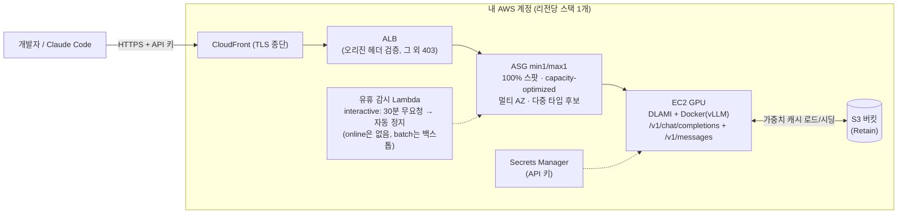

# token-forge

[English](README.md) | **한국어** | [日本語](README.ja.md)

**내 AWS 계정 안에서 도는 프라이빗 바이브 코딩 LLM.** 오픈 웨이트 모델을 **100% 스팟
인스턴스**로 값싸게 서빙하고, 상시 수집되는 **공개 스팟 인텔리전스 피드**(배치점수 추이)로
"어느 리전에서 GPU 스팟이 잡히는가"를 데이터로 푼다. Claude Code 등 코딩 에이전트가
바로 붙는 OpenAI·Anthropic 호환 API를 제공하며, 프롬프트·응답·사용량 통계는 계정 밖으로
나가지 않는다.

**검증된 모델 카탈로그** (전부 실서빙 검증):

| 모델 | 급 | 인스턴스 | 비고 |
|---|---|---|---|
| [Qwen3-Coder-30B](https://huggingface.co/Qwen/Qwen3-Coder-30B-A3B-Instruct-FP8) | 30B MoE | g6e.12xlarge (약 $2.6/h 스팟) | 권장 기본 — 비용 예시에 쓰는 시간당 단가의 기준 |
| [GLM-4.6](https://huggingface.co/zai-org/GLM-4.6-FP8) | 355B MoE | p5.48xlarge | 대형 선택지 |
| [Solar-Open2-250B](https://huggingface.co/upstage/Solar-Open2-250B) | 250B MoE | p5.48xlarge / g6e.48xlarge | 전용 vLLM 포크 사용 |

> 제품 방향: [PR/FAQ](docs/prfaq.md) · 요건: [v1 요건 정의](docs/superpowers/specs/2026-08-22-token-forge-v1-requirements.md) · 초기 설계: [2026-07-23 설계 문서](docs/superpowers/specs/2026-07-23-token-forge-design.md)

## 왜 token-forge인가

세 가지 축이 핵심이고, 전부 실배포 실측으로 뒷받침된다 — 근거와 수치는
**[비용·보안·편의 상세](docs/value-proposition.md)** 참고.

- **비용 — 부팅·유휴를 포함한 GPU 실행 시간만큼**: 100% 스팟(온디맨드의 약 3분의 1에서 4분의 1) +
  GPU 정지 시점을 정하는 사용 모드(interactive: 무요청 30분, batch: 작업 직후, online: 정지 없음) +
  실패 경로마다 GPU를 0으로 되돌리는 비용 가드 + 가중치는 저가 CPU 스팟이 선시딩(실측 8분/$0.03).
  30B급 월 $100-200 목표는 사용 시간이 제한된 interactive·batch 사용에서만 성립한다. 24시간 도는
  online 엔드포인트는 $2.60/h 기준 월 약 $1,872다. GPU를 켜지 않은 달은 GPU 요금이 0이지만, ALB와
  S3 캐시는 `tkf down --purge` 전까지 과금된다. [사용 모드와 실제 비용](#사용-모드와-실제-비용) 참고.
- **보안 — 불반출이 아키텍처**: 추론·프롬프트·사용량 통계 모두 내 계정 안에서 완결,
  텔레메트리 없음(외부 통신은 HF 다운로드·AWS API·피드 익명 GET 3종뿐 — 피드마저
  자가 수집기로 대체 가능). 전송은 CloudFront TLS가 기본이고 ALB 우회 접근은 403,
  소스 IP 허용목록(`-c allowedCidrs=`)과 `tkf rotate-key` 키 회전 제공. 전부 OSS라
  직접 감사할 수 있다.
- **편의 — 리전을 몰라도 된다**: `tkf up` + `tkf connect claude` 명령 2개. 배치점수
  48h 추이·RTT·가격·쿼터로 리전을 자동 선정하고 후보들에 병렬로 확보를 시도해 먼저
  잡힌 곳만 남긴다(First-Acquired-Wins). Anthropic `/v1/messages` 네이티브 + prefix
  caching(TTFT 실측 0.82초 → 0.14초)으로 Claude Code가 그대로 붙는다.

## 누가 써야 하나

한 문장으로: **코드를 외부로 못 보내거나, 토큰을 아주 많이 쓰거나, GPU를 몰아서 쓰는**
개발자.

**적합한 경우:**

1. **프라이버시 제약이 있는 개발자** — 회사 규정·규제로 외부 LLM API에 코드를 못 보내는
   경우. 추론·프롬프트·사용량 통계까지 자기 AWS 계정 안에서 완결되고 전체가 OSS라 감사
   가능하다. 이 그룹에게 대안은 상용 API가 아니라 "아무것도 없음"이다.
2. **한도에 묶인 헤비 파워유저** — 에이전트 팬아웃으로 일 100M+ 토큰을 태우는 경우.
   토큰이 아니라 GPU 시간에 과금되므로 GPU가 도는 동안 토큰은 무제한이라, 이 물량부터 동일 모델 API와 동률이 되고
   상용 1차 API 대비 수 배 저렴해진다. 128K 컨텍스트 정액도 티어 과금 API 대비 이점.
3. **배치 워크로드 운영자** — 야간 대량 코드 분석·생성처럼 GPU를 채워 쓰는 경우.
   가동률이 오르면 토큰 단가가 3-5배 개선되는 스팟의 최적 지점이다.
4. **AWS 크레딧·커밋(EDP) 보유 조직** — API 비용은 별도 지출이지만 GPU 스팟은 기존
   AWS 커밋 안에서 소진된다.

**맞지 않는 경우:**

- **라이트 유저** — 월 수십M 토큰 이하면 동일 오픈 웨이트 모델을 서빙하는 서드파티
  API가 압도적으로 싸다. 이 구간에서 token-forge를 고를 이유는 프라이버시뿐이다.
- **무중단이 필요한 서비스** — 스팟 회수 시 수 분의 재확보 공백을 감수하는 설계(R3)라
  SLA가 있는 프로덕션 서빙에는 부적합하다.
- **최상위 모델 품질이 필수인 워크로드** — 오픈 웨이트 30B-355B급으로 부족하다면 맞지
  않다.
- AWS 계정·쿼터 관리 자체가 부담인 경우 — 첫 진입에 스팟 쿼터 증설 신청이 필요하다.

## 아키텍처



모델·인스턴스 조합은 `models/<model>.yaml`의 프로파일로 선택한다. 메인라인 vLLM이
기본이고, 전용 포크가 필요한 모델(예: Solar Open2)만 yaml에서 이미지를 바꾼다.
prefix caching이 기본이라 바이브 코딩의 반복 컨텍스트에 유리하다.

> 내부 구조·부팅 시퀀스·수집기까지 포함한 상세 안내:
> **[아키텍처 문서](docs/architecture.md)** (신규 참가자용, 다이어그램 중심)

## 스팟 인텔리전스 공개 대시보드·데이터 피드

roboco가 상시 운영하는 **GPU 스팟 확보 가능성(배치점수) × 가격 공개 서비스**:

- **대시보드**: https://spot.roboco.io — p5·g6e 주요 타입의 리전/AZ별
  배치점수 추이, 스팟 가격, 요일×시간 히트맵, 가성비 랭킹 (1시간 주기 갱신, 90일 이력)
- **데이터 피드**: https://d16jdvzof4zpo7.cloudfront.net/data.json — CORS 전면 허용.
  스키마·이용법은 [docs/spot-feed.md](docs/spot-feed.md)

같은 수집기를 자기 계정에 직접 띄우려면 `cdk deploy -c collector=1` (별도 상시 스택).

## 사전 조건

- **스팟 vCPU 쿼터** — 대부분 계정 기본 0. 30B급(g6e.12xlarge)은 **48개**, 48xlarge
  대형 모델은 **192개** 필요. Service Quotas에서 p5는 "All P Spot Instance
  Requests"(L-7212CCBC), g6e는 "All G and VT Spot Instance Requests"(L-3819A6DF) 상향
  신청. 신규 계정은 부분 승인이 흔하므로 **[EC2 쿼터 증설 요청 가이드](docs/ec2-quota-guide.md)**
  의 어필 문안 작성법 참고.
- 비용 참고 (스팟, 리전·시점 변동): g6e.12xlarge 약 **$2.6/hr**, g6e.48xlarge 약
  **$10-13/hr**, p5.48xlarge 약 **$30-50/hr**. 기본 interactive 모드는 유휴 자동 정지가 켜져 있지만 장기
  미사용 시 `cdk destroy` 권장.
- Node 20+, 부트스트랩된 계정(`cdk bootstrap`). AWS CDK CLI는 패키지 의존성에
  포함되어 있어 별도 설치가 필요 없다 (소스로 설치할 때만 별도 설치 필요).

## tkf CLI (권장 인터페이스)

cdk 컨텍스트와 scripts/*.sh를 직접 다루는 대신 통합 CLI를 쓸 수 있다:

```bash
npm install -g @roboco/token-forge   # tkf 명령 설치
# 또는 소스에서 설치:
# npm install && npm run build && npm link
tkf model list                              # 검증된 모델 카탈로그
tkf placement qwen3-coder-30b               # 리전 추천 표 (배치점수 48h·RTT·가격·쿼터)
tkf seed qwen3-coder-30b                    # 가중치 S3 선시딩만 (GPU 0대, 리전 선택 프롬프트)
tkf up qwen3-coder-30b                      # 리전 자동 선정 + 병렬 레이스 기동 (R10)
tkf up qwen3-coder-30b --region ap-northeast-2   # 리전 직접 지정
tkf up qwen3-coder-30b --usage-mode online  # online: 유휴 정지 없음, READY 후 최소 용량 1
tkf run qwen3-coder-30b --region ap-northeast-2 -- python job.py   # batch: 작업 동안만 GPU
tkf status                                  # 상태 확인
tkf connect claude                          # Claude Code 연결 (source ~/.token-forge/env.sh)
tkf down                                    # GPU 정지 (--purge: 완전 삭제, --region: 대상 지정)
tkf rotate-key                             # API 키 회전 (가동 중이면 재기동 시 적용)
tkf config set standby single               # 스탠바이 정책: race(기본, K=2) | single | lazy
```

`tkf up`에서 `--region`을 생략하면(`tkf run`은 항상 필수) 배치 엔진이 공개 피드의 48시간 배치점수 평균, EC2 엔드포인트
RTT(24h 캐시), 스팟 가격, 계정 쿼터를 종합해 후보 리전을 서열화하고(안정성 → 레이턴시
→ 가격), 상위 K개 리전에 동시에 스팟을 요청해 먼저 확보한 리전만 남긴다(First-Acquired-
Wins). 피드가 대상 타입을 커버하지 않으면 실시간 배치점수로 자동 폴백한다.

병렬화 이전의 과거 참고치: 첫 `up`은 선시딩 포함 약 20분, 이후에는 캐시 부팅으로 약 8분(스팟 즉시 배정 기준).
프라이버시 모드는 `tkf config set feedUrl <자가 수집기 URL>`로 피드 조회조차 자기 계정
안에서 해결할 수 있다.

## 배포

```bash
npm install
cdk deploy -c model=solar-open2-250b -c profile=int4-g6e -c region=ap-northeast-1
# 프로파일: int4(p5) / int4-g6e(g6e, 저비용) / bf16(p5)
# 옵션: -c azs=... -c minCapacity=0 -c idleMinutes=60 -c alertEmail=you@example.com
#       -c usageMode=interactive|batch|online  (사용 모드 절 참고)
#       -c allowedCidrs=203.0.113.0/24  (소스 IP 허용목록 — 그 외 전부 403)
```

어느 리전·시간대에 스팟이 잘 잡히는지는 위의 **공개 대시보드**를 먼저 확인하면
실패 루프를 크게 줄일 수 있다.

기존 배포를 이 버전으로 업데이트하면 EndpointUrl이 https로 바뀌므로 `tkf connect claude`를
다시 실행해야 한다.

첫 부팅은 HF 다운로드 + S3 시딩으로 오래 걸린다(INT4 약 150GB).
이후 재프로비저닝은 S3 캐시에서 s5cmd 로드로 단축(목표 약 15분).

### 새 모델 온보딩 — 가중치 선시딩 권장 (GPU 비용 절약)

첫 다운로드를 GPU 인스턴스에서 하면 다운로드 시간만큼 GPU 요금을 낸다
(실측: GLM-4.6 337GB ≈ 50분 × p5 스팟 $22/h ≈ $18). 저가 CPU 스팟으로 먼저 시딩하자:

```bash
cdk deploy -c model=<m> -c profile=<p> -c region=<r> -c minCapacity=0  # 스택만 생성, GPU 0대
scripts/seed-weights.sh <stack-name> <region>   # c6id 스팟(약 $0.2/h)이 HF→S3 시딩 후 자동 종료
scripts/start.sh <stack-name> <region>          # GPU는 S3 캐시로 약 15분 내 서비스
```

## 사용

```bash
API_KEY=$(aws secretsmanager get-secret-value \
  --secret-id <ApiKeySecretArn 출력값> --query SecretString --output text)
scripts/smoke-test.sh <EndpointUrl 출력값> "${API_KEY}"
```

OpenAI SDK: `base_url="<EndpointUrl>/v1"`, `api_key=${API_KEY}`.

## 새 모델 추가

`models/<model-name>.yaml` 1개 추가 → `cdk deploy -c model=<model-name> -c profile=<profile>`.
스키마는 `models/solar-open2-250b.yaml` 참고 (`vllmImage`, `profiles.<name>.{weightsRepo,instanceType,vllmFlags,maxModelLen}`).

## 트러블슈팅

| 증상 | 확인 |
|---|---|
| 30분 넘게 InService 0 (SNS 알람) | 스팟 쿼터/용량 부족. Service Quotas·공개 대시보드로 다른 리전 검토 |
| g6e에서 vLLM이 CUDA 그래프 캡처 중 크래시 | INT4 MoE + TP=8은 `--enable-expert-parallel` 필수 (`int4-g6e` 프로파일에 포함됨) |
| 인스턴스가 계속 교체됨 | SSM 세션 접속 → `cat /var/log/token-forge/events.jsonl`, `docker logs vllm` (OOM 등). vLLM 컨테이너 로그는 CloudWatch Logs 그룹 `/token-forge/vllm`에서도 확인 가능 (인스턴스 종료 후에도 보존) |
| 스팟 중단 알림 수신 | 정상 — ASG가 자동 재프로비저닝. S3 캐시로 약 15분 내 복구 |
| HF 다운로드 3회 실패 | 로그 확인 후 인스턴스 종료(ASG 교체) 또는 네트워크 점검 |

## 사용 모드와 실제 비용

GPU 요금은 프롬프트를 입력한 시간이 아니라 인스턴스가 실행된 시간에 비례한다.

> GPU 비용 = 시간당 스팟 단가 × (추론 시간 + 부팅 시간 + 유휴 실행 시간)

부팅 시간(S3 캐시 과거 참고치 약 8분, 개선 후 실측 아님)과 자동 정지 전까지의 유휴 시간도 추론과 같은 단가로 과금된다.
ALB, S3, EBS, Secrets Manager, CloudWatch 요금은 별도다. `tkf down`은 ASG를 0으로 설정하고, 인스턴스 종료에는 보통 몇 분이 걸린다(`tkf status`로
확인). GPU 과금은 명령이 끝난 시점이 아니라 인스턴스가 종료된 시점에 멈춘다. 그 뒤에도
ALB(리전당 약 $16/월), S3 가중치 캐시, 시크릿은 `tkf down --purge` 전까지 남는다. EBS 루트 볼륨은
인스턴스가 있는 동안에만 과금된다. 아래 금액은 $2.60/h(g6e.12xlarge 스팟)를 가정한 예시이며
실시간 가격이 아니다. 실제 스팟 가격은 리전과 시점에 따라 바뀐다.

"요청 없음"만으로는 배치 작업 완료, 대화형 사용자의 휴식, 트래픽을 기다리는 온라인 서비스를
구분할 수 없다. 그래서 `tkf`는 사용 모드를 선택하게 한다. 사용 모드는 모델 양자화
프로파일(`--profile`)과 별개다.

| 모드 | GPU 정지 방식 | 정지 정책에서 생기는 월 GPU 비용 예시 |
| --- | --- | --- |
| `interactive` (기본) | ALB 요청이 N분(기본 30) 없으면 정지 | 유휴 30분 × 하루 2회 × 30일 = $78, 10분이면 $26 |
| `batch` | `tkf run`이 작업 종료(성공·실패·취소·시간 제한) 즉시 정지 | 부팅 + 작업 시간, 그리고 정지 요청·인스턴스 종료까지의 몇 분. 유휴 대기는 없음 |
| `online` | 자동 정지 없음, READY 후 최소 용량 1 | $2.60 × 24 × 30 = $1,872 |

**interactive** — `tkf up <model>`(또는 `--usage-mode interactive`). 유휴 시간은
`--idle-minutes N`(CLI) 또는 `-c idleMinutes=N`(CDK)으로 바꾼다. N은 5-1440 범위의 5의 배수이거나,
비활성화를 뜻하는 0이어야 한다. CloudWatch가 ALB `RequestCount`를 5분 단위로 평가하므로 그 밖의 값은
내림하지 않고 거부하며, 실제 정지는 N분보다 몇 분 늦을 수 있다. 기본값 30분은 의도적으로 유지한다.
유휴 감시는 요청 수만 보므로 실행 중인 긴 스트리밍 응답이나 대기 중인 작업을 알지 못한다. 기본값을
안전하게 줄이려면 실행·대기 요청 수를 확인하는 별도 활동 감시가 필요하다. 그 전까지는 긴 무응답
요청이 없는 사용 패턴일 때만 직접 짧은 값을 설정한다.

**batch** — 작업 수명 동안만 GPU를 소유하는 작업을 실행한다.

```bash
tkf run qwen3-coder-30b --region ap-northeast-2 [--timeout 120] [--boot-timeout 30] -- python analyze.py --all
```

`tkf run`은 스택을 batch 모드로 배포 또는 갱신하고, GPU 1대를 기동해 READY를 기다린 뒤 `--` 뒤의
명령을 셸 없이 인자 배열 그대로 실행한다. 자식 프로세스는 `TKF_ENDPOINT`, `TKF_MODEL`, `TKF_API_KEY`,
`OPENAI_BASE_URL`, `OPENAI_API_KEY` 환경변수를 받으며, 키는 출력하지 않는다. 작업이 도는 동안
`tkf run`이 1분마다 엔드포인트를 핑하므로 요청 기반 유휴 정지는 발화하지 않는다. 작업이 성공·실패하거나,
취소(Ctrl-C, SIGTERM, SIGHUP)되거나, `--timeout`(기본 120분, `0` = 무제한)을 넘으면 `tkf run`이 ASG를
min/desired 0으로 설정하고 ASG를 다시 읽어 desired=0을 확인한다. 이 확인은 정지 요청이 받아들여졌다는
뜻이며, 인스턴스가 이미 종료됐다는 뜻은 아니다. 명령은 별도 프로세스 그룹에서 실행된다. 시간 제한이나
취소 시 SIGTERM을 받고 10초 뒤 SIGKILL을 받으며, 명령이 끝나면 그룹에 남은 프로세스(손자 프로세스)도
종료된다. `setsid` 등으로 그룹을 벗어난 프로세스는 추적하지 않는다. 표준 입력이 터미널이면 명령에
stdin을 주지 않고, 파이프로 들어온 stdin은 그대로 전달한다. 종료 코드는 작업의 종료 코드다(124 = 시간 제한,
127 = 명령 실행 불가, 130/143 = 취소). 정리에 실패하면 작업 결과와 정리 오류를 함께 보고하고, 작업이
성공했더라도 0이 아닌 코드로 끝난다.

`tkf run`은 해당 리전의 스택에서 GPU가 이미 실행 중이거나 요청된 상태(다른 세션, 온라인 서비스,
이전 실행)이면 시작을 거부한다. 따라서 보이는 인스턴스는 인수하거나 정지하지 않는다. 같은 순간에 시작하는
다른 호스트는 볼 수 없다(아래 참고). ASG 검사는
스택 갱신 전과 용량을 올리기 직전에 두 번 한다. `~/.token-forge/locks/`의 잠금 파일은 실행 중에 같은
호스트의 두 번째 `tkf run`과 `tkf up`/`tkf seed`가 그 스택을 쓰지 못하게 한다. 비정상 종료 후 남은 잠금은
자동으로 지우지 않는다. 오류 메시지에 보유 PID와 파일 경로가 나오므로 그 프로세스가 없음을 확인한 뒤
지운다. 호스트 간 잠금은 없다. 두 호스트가 같은 순간에 시작하면 둘 다 ASG 검사를 통과할 수 있다.

`tkf run` 자체가 SIGKILL로 죽거나 호스트가 유실되면 정리를 할 수 없다. 이때는 핑이 끊기고, 스택의
유휴 알람(백스톱, 기본 30분, `--idle-minutes`로 변경, 0은 허용하지 않음)이 GPU를 정지할 수 있다. 그러나
이는 보장되지 않고 시각도 정확하지 않다. 정지 Lambda는 알람이 ALARM으로 바뀔 때만 실행된다. 부팅 프로브가
알람을 ALARM에서 벗어나게 하기 전(GPU 요청 후 대략 처음 5-10분)에 실행이 죽으면 새 상태 변화가 없어 GPU가
계속 실행된다. 정상적인 경우에도 5분 단위 평가와 이벤트 전달 때문에 설정 시간보다 몇 분 늦게 정지된다.
비정상 종료 뒤에는 항상 `tkf down --region <region>`을 실행하고 `tkf status`로 확인한다.

**online** — `tkf up <model> --usage-mode online`은 유휴 정지를 끄고, READY 후 ASG 최소 용량을 1로
설정한다. 인스턴스는 여전히 스팟이므로 중단되면 ASG가 교체하는 몇 분 동안 응답이 끊긴다. 스택 생성과
부팅 중에는 최소 용량을 0으로 두며, `tkf down`은 항상 min/desired를 0으로 설정한다.

사용 모드는 스택(모델·프로파일·리전마다 1개)에 속한다. 요청한 모드나 유휴 시간이 기존 스택과 다르면
`tkf up`/`tkf run`이 GPU를 올리기 전에 `cdk deploy`로 스택을 갱신한다.
갱신 배포는 스택이 `DeploymentSettings` 출력에 기록한 `allowedCidrs`, `azs`, `alertEmail`을 그대로 다시 전달하므로
IP 허용목록, AZ 선택, 알림 구독이 유지된다. 바뀌는 것은 유휴 알람·Lambda, ASG 최소 용량, 출력뿐이므로 Launch
Template과 실행 중인 인스턴스는 교체되지 않는다. 이 기록이 없거나 해석할 수 없으면 `tkf`는 스택을 자동으로
갱신하지 않고, 최초 배포 때의 컨텍스트를 붙여 실행할 `npx cdk deploy` 명령을 안내한다.

이 기능 이전에 만든 스택의 마이그레이션: 이런 스택에는 모드와 설정 기록이 없다. 옵션 없는 `tkf up`(interactive,
30분)은 이전처럼 그대로 사용한다. `--usage-mode online`, 다른 `--idle-minutes`, `tkf run`을 쓰려면 먼저 최초 배포와
같은 컨텍스트로 한 번 수동 갱신한다. 예:
`npx cdk deploy -c model=<m> -c profile=<p> -c region=<r> -c minCapacity=0 -c usageMode=interactive -c idleMinutes=30 [-c allowedCidrs=... -c azs=... -c alertEmail=...]`.
CDK를 직접 쓸 때는 `-c usageMode=interactive|batch|online`을 쓴다.
충돌하는 설정은 synth 단계에서 실패한다: `online`에 0이 아닌 `idleMinutes`, `batch`에
`idleMinutes=0` 또는 `minCapacity=1`, 알 수 없는 모드.

## 비용 절감 (실험용 운영)

- **유휴 자동 셧다운(interactive 모드 기본 켜짐)**: ALB 요청이 30분간 없으면 인스턴스를 자동으로 0대로 내리고 SNS로 알린다.
  간격 변경 `-c idleMinutes=60`(5의 배수, 5-1440), 비활성화 `-c idleMinutes=0`. online 모드에는 유휴 정지가 없고,
  batch 모드는 백스톱으로만 쓴다. [사용 모드](#사용-모드와-실제-비용) 참고.
- **수동 온/오프**:
  ```bash
  scripts/stop.sh  <stack-name> <region>   # GPU 비용 정지 (ALB/S3만 유지, 약 $16/월)
  scripts/start.sh <stack-name> <region>   # 재기동 — S3 캐시로 수 분에서 15분 내 서비스 복귀
  ```
- **장기 미사용**: `cdk destroy` 권장. S3 가중치 캐시는 Retain으로 남아 재배포 시 고속 부팅.

## 스코프 (YAGNI)

오토스케일링 없음(min1/max1), 웹 UI 없음. 엔드포인트는 CloudFront 경유 HTTPS가 기본이며
(도메인 불요), ALB 직접 접근은 오리진 검증 헤더가 없어 403이다. 소스 IP 허용목록은
`-c allowedCidrs=`로 켠다. 비스트리밍 요청은 CloudFront 응답 대기 상한(60초)의 적용을
받으므로 장시간 생성은 스트리밍(stream)을 사용할 것.

## 프로젝트 방향

목표는 **현존·미래의 오픈 웨이트 LLM을 스팟으로 값싸게, 그러면서도 안정적으로 쓰는
프라이빗 LLM 플랫폼**이다. [v1 요건(R1-R11)](docs/superpowers/specs/2026-08-22-token-forge-v1-requirements.md)이
확정되어 단계적으로 구현 중:

- **통합 CLI** (`tkf up/down/status/model/connect`) — 1단계 완료, 위의 tkf CLI 절 참고
- **지능형 배치(R10)** — 배치점수 추이·레이턴시·가격·쿼터로 최적 리전을 자동 선정하고,
  후보 리전들에 병렬로 확보를 시도해 먼저 잡힌 곳만 남기는 레이스(First-Acquired-Wins)
  — 2단계 완료, 위의 tkf CLI 절 참고
- **바이브 코딩 1급 지원** — Anthropic 호환 API(`/v1/messages`), prefix caching,
  Claude Code 도구 호출까지 실배포 검증 완료
- **전송 보안(R11)** — TLS 종단, API 키 회전, 소스 IP 허용목록

이런 운영을 직접 하고 싶지 않다면(매니지드 형태에 관심이 있다면) 이슈로 의견을 남겨 달라.
사용 사례가 로드맵을 결정한다.

### 부팅 계측과 재현 가능한 비교

이미지 준비와 S3/HF 가중치 준비를 병렬 실행하고 로컬 이미지는 재사용한다. 두 작업 성공 뒤
컨테이너를 시작하고 로컬 `/health`를 유한 대기한다. 기존 약 8분은 병렬화 전 과거 참고치다.
첫 기동(HF 다운로드+시딩), S3 캐시 hit, 로컬 이미지 hit를 구분한다. 개선 후 실측 시간·절감률은 아직 없다.

기존 SSM 접속으로 호스트 `/var/log/token-forge/events.jsonl`을 로컬에 복사하거나,
스택 출력 `BootLogGroupName`의 로그 그룹(7일 보존)을 읽기 조회로 내보낸다.

```bash
GROUP=$(aws cloudformation describe-stacks --stack-name "$STACK" --region "$REGION" \
  --query 'Stacks[0].Outputs[?OutputKey==`BootLogGroupName`].OutputValue' --output text)
aws logs filter-log-events --log-group-name "$GROUP" --region "$REGION" --output json > events.json
tkf boot-report --file events.json
tkf boot-report --file one-boot.jsonl --hourly-price 1.20 --launch-time 2026-10-31T00:00:00Z --json
```

비용 계산 전 파일을 한 boot ID로 제한하고 해당 인스턴스의 EC2 `LaunchTime`을 확인한다.
예시 단가·시각은 교체해야 한다. 명시 단가와 유효 launch anchor가 모두 있어야 근사 비용을 낸다.
호스트 시작→로컬 READY는 부분 관측이다. launch→READY의 고정 단가 계산도 청구서가 아니다.
CLI 전체 대기에는 준비·시딩·스팟 확보·엔드포인트 관측 지연이 포함된다. serving·idle tail·종료 전파·전체
세션 비용 배분은 측정하지 않는다. 누락/실패를 $0으로 표시하지 않으며 동시 단계 시간을 합산하지 않는다.

별도 승인된 GPU A/B 실험에서는 동일 rendered user-data·모델/이미지 digest·인스턴스 타입·리전·캐시 상태로
호스트 환경의 `TKF_BOOT_MODE=serial`과 `TKF_BOOT_MODE=parallel`(기본)을 비교한다. CDK context는 추가하지 않았다.
격리된 실험 호스트에서 재실행하려면 `sudo env TKF_BOOT_MODE=serial bash /var/lib/cloud/instance/user-data.txt`를
쓰고 parallel로 반복한다. 실행 중 GPU를 사용하며 vLLM을 재시작한다. 재실행은 캐시를 데우므로 신규 호스트와
동일한 조건이 아니다. 각 조건을 여러 번 반복하고 첫 기동/S3/로컬 이미지 조건별 중앙값·범위·실패·호스트 구간·
launch anchor를 분리 기록한다. 동시 다운로드는 디스크·네트워크 경합을 일으킬 수 있다. 기존 비용 가드에 따라
실험 후 즉시 GPU를 정지한다.

배치 전송은 유한한 best effort다. 실패와 HTTP 200 부분 거부는 호스트의 upload 이벤트에 남으며 추론 시작을
막지 않는다. 즉시 종료/호스트 유실 시 마지막 이벤트가 유실될 수 있고, 원격 실패 이벤트 부재가 전송 성공의
증거는 아니다. 스키마·상한은 [아키텍처](docs/architecture.md)를 참고한다. 이전 격리 GPU 실측과 한계는 아래 보고서에 기록했다. 실제 청구액은 검증하지 않았으며 최종 소스 변경은 로컬 회귀 검증만 했다.

전송 상태는 독립 순번의 호스트 전용 telemetry이며 재전송하지 않는다. 로컬 파일 쓰기 실패는
stderr에 `TKF_LOCAL_LOG_WRITE_FAILED`를 남기고 기동·원격 전송을 계속하지만 호스트 원본이 없을 수 있다.
SIGINT/SIGTERM은 준비 프로세스 그룹을 정리한다. supervisor의 SIGKILL/OOM은 자손 정리나 최종 기록을 보장하지 않는다.

루트 디스크 기본값은 gp3 200 GiB, 3,000 IOPS, 처리량 500 MiB/s다. Ohio에서 추가 375 MiB/s는 상시 볼륨 기준 약 $15/월($0.04/MiB/s-month)이며 임시 볼륨은 사용 시간에 비례한다. 기존 스택은 명시적 `cdk deploy`가 필요하고, 이미 실행 중인 인스턴스의 디스크를 자동 변경하지 않는다. 부팅 단축 효과는 보장되지 않으며 실측으로 확인해야 한다. [Ohio 1회 실측과 한계](docs/superpowers/plans/2026-10-31-boot-throughput.md)를 참고한다.

선택한 부팅 경로는 리전별 SSM GPU DLAMI, 이미지·가중치 병렬 준비, 위 루트 설정이다. Ohio 2c g6e.12xlarge Spot에서 Qwen3-Coder-30B FP8, vLLM 0.27.1, TP4/EP/131072, S3 가중치 hit·이미지 pull 조건으로 launch→로컬 READY **288.210초**를 1회 관측했다. 이전 125 MiB/s 실행은 477.441초였고, 병렬화만의 serial 대비 차이는 6.186초였다. 서로 다른 시점의 단일 실행이므로 보편적 단축을 보장하지 않는다. AOT cache가 실제 재사용된 prepared AMI는 617.075초로 느려 제품 부팅 경로에서 제외했다. 현재 소스에는 API 키 인자 전달·인자 로그 수정도 포함되며, 이는 로컬 회귀 테스트로 검증했고 새 라이브 벤치마크는 하지 않았다. [실험 결과와 한계](docs/superpowers/plans/2026-10-31-prebootstrap.md)를 참고한다.
