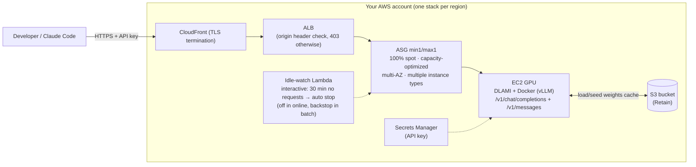

# token-forge

**English** | [한국어](README.ko.md) | [日本語](README.ja.md)

**A private vibe-coding LLM that runs inside your own AWS account.** It serves open-weight
models cheaply on **100% spot instances**, and a continuously-running **public spot
intelligence feed** (placement-score trends) turns "which region has GPU spot capacity
right now" into a data-driven answer. It exposes an OpenAI/Anthropic-compatible API that
coding agents like Claude Code can plug into directly, and your prompts, responses, and
usage stats never leave your account.

**Verified model catalog** (all validated against real serving deployments):

| Model | Class | Instance | Notes |
|---|---|---|---|
| [Qwen3-Coder-30B](https://huggingface.co/Qwen/Qwen3-Coder-30B-A3B-Instruct-FP8) | 30B MoE | g6e.12xlarge (about $2.6/h spot) | Recommended default — the hourly price used in the cost examples |
| [GLM-4.6](https://huggingface.co/zai-org/GLM-4.6-FP8) | 355B MoE | p5.48xlarge | Large-scale option |
| [Solar-Open2-250B](https://huggingface.co/upstage/Solar-Open2-250B) | 250B MoE | p5.48xlarge / g6e.48xlarge | Requires a dedicated vLLM fork |

> Product direction: [PR/FAQ](docs/prfaq.md) (Korean) · Requirements: [v1 requirements](docs/superpowers/specs/2026-08-22-token-forge-v1-requirements.md) (Korean) · Original design: [2026-07-23 design doc](docs/superpowers/specs/2026-07-23-token-forge-design.md) (Korean)

## Why token-forge

Three pillars matter here, and all three are backed by measurements from real deployments —
see **[cost, security, and convenience details](docs/value-proposition.md)** (Korean) for the
evidence and numbers.

- **Cost — you pay for GPU running time, including boot and idle time**: 100% spot (roughly
  a quarter to a third of on-demand pricing) + a usage mode that decides when the GPU stops
  (interactive: 30 minutes without requests, batch: right after the job, online: never) + a
  cost guard that resets GPU capacity to zero on every failure path + weights pre-seeded via
  cheap CPU spot instances (measured at 8 minutes / $0.03). A $100-200/month target for a
  30B-class model holds only for interactive or batch use with limited hours; an online
  endpoint that runs 24 hours costs about $1,872/month at $2.60/h. GPU charges are $0 in
  months you don't start a GPU, but the ALB and S3 cache are still billed until
  `tkf down --purge`. See [Usage modes and what you actually pay](#usage-modes-and-what-you-actually-pay).
- **Security — no-exfiltration by architecture**: inference, prompts, and usage stats stay
  entirely inside your account, with no telemetry (the only outbound traffic is HF
  downloads, AWS API calls, and anonymous GET requests to the feed — and even the feed can
  be replaced with your own self-hosted collector). Transport defaults to CloudFront TLS,
  direct ALB access returns 403, and you get a source-IP allowlist (`-c allowedCidrs=`) plus
  key rotation via `tkf rotate-key`. Everything is open source, so you can audit it yourself.
- **Convenience — you don't need to know the region**: just two commands, `tkf up` and
  `tkf connect claude`. Region selection is automated from 48-hour placement-score trends,
  RTT, pricing, and quota, and the tool races capacity acquisition across candidate regions
  in parallel, keeping only whichever region wins first (First-Acquired-Wins). Native
  Anthropic `/v1/messages` support plus prefix caching (measured TTFT dropping from 0.82s to
  0.14s) means Claude Code connects without any adjustment.

## Who is this for

In one sentence: developers who **cannot send code outside, consume very large token
volumes, or run GPU workloads in concentrated bursts**.

**A good fit if you are:**

1. **A developer under privacy constraints** — company policy or regulation forbids
   sending code to external LLM APIs. Inference, prompts, and even usage statistics stay
   inside your own AWS account, and the whole stack is open source and auditable. For
   this group the alternative is not a commercial API but "nothing at all".
2. **A heavy power user hitting subscription limits** — agent fan-out burning 100M+
   tokens a day. You pay for GPU hours, not tokens, so tokens are unlimited while the GPU runs: from this
   volume on, self-hosting matches same-model API pricing and beats first-party commercial
   APIs by multiples. Flat-rate 128K context also avoids context-tiered API billing.
3. **A batch workload operator** — nightly bulk code analysis or generation that fills
   the GPU. Higher utilization improves token unit cost by 3-5x, the sweet spot for spot.
4. **An organization with AWS credits or committed spend (EDP)** — API bills are separate
   spend, but GPU spot burns down your existing AWS commitment.

**Not a good fit if you:**

- **Use it lightly** — below tens of millions of tokens a month, third-party APIs serving
  the same open-weight models are far cheaper. In that range the only reason to choose
  token-forge is privacy.
- **Need uninterrupted service** — the design accepts a few minutes of re-acquisition gap
  on spot reclaim (R3); it is not for SLA-bound production serving.
- **Require frontier-model quality** — if open-weight 30B-355B models are not enough,
  this is not the tool.
- Find AWS account and quota management itself a burden — the first run requires a spot
  quota increase request.

## Architecture



The model/instance combination is selected through a profile in `models/<model>.yaml`.
Mainline vLLM is the default; only models that need a dedicated fork (e.g., Solar Open2)
override the image in their yaml. Prefix caching is on by default, which favors the
repeated-context patterns typical of vibe coding.

> For internal architecture, boot sequence, and the collector, see the detailed guide:
> **[architecture docs](docs/architecture.md)** (Korean, diagram-heavy, aimed at new
> contributors)

## Public spot intelligence dashboard and data feed

roboco runs an always-on **GPU spot availability (placement score) x pricing public
service**:

- **Dashboard**: https://spot.roboco.io — placement-score trends by
  region/AZ for the major p5 and g6e instance types, spot pricing, a day-of-week x
  hour-of-day heatmap, and a value-for-money ranking (refreshed hourly, 90-day history)
- **Data feed**: https://d16jdvzof4zpo7.cloudfront.net/data.json — fully CORS-enabled.
  Schema and usage details in [docs/spot-feed.md](docs/spot-feed.md) (Korean)

To run the same collector directly in your own account, use
`cdk deploy -c collector=1` (a separate, always-on stack).

## Prerequisites

- **Spot vCPU quota** — most accounts start at 0. A 30B-class model (g6e.12xlarge) needs
  **48**, and 48xlarge-class large models need **192**. In Service Quotas, request an
  increase for "All P Spot Instance Requests" (L-7212CCBC) for p5, or "All G and VT Spot
  Instance Requests" (L-3819A6DF) for g6e. New accounts are often only partially approved
  — see the **[EC2 quota increase request guide](docs/ec2-quota-guide.md)** (Korean) for
  how to write an effective appeal.
- Cost reference (spot pricing, varies by region and time): about **$2.6/hr** for
  g6e.12xlarge, about **$10-13/hr** for g6e.48xlarge, and about **$30-50/hr** for
  p5.48xlarge. Idle auto-shutdown is on in the default interactive mode, but `cdk destroy` is recommended for
  extended periods of non-use.
- Node 20+, and a bootstrapped account (`cdk bootstrap`). The AWS CDK CLI is bundled as a
  package dependency, so you don't need to install it separately (only required as a
  separate install if you're installing from source).

## tkf CLI (recommended interface)

Instead of working with cdk context flags and scripts/*.sh directly, you can use the
unified CLI:

```bash
npm install -g @roboco/token-forge   # install the tkf command
# or, to install from source:
# npm install && npm run build && npm link
tkf model list                              # verified model catalog
tkf placement qwen3-coder-30b               # region recommendation table (48h placement score, RTT, price, quota)
tkf seed qwen3-coder-30b                    # pre-seed weights to S3 only (0 GPUs, prompts for a region)
tkf up qwen3-coder-30b                      # auto region selection + parallel race launch (R10)
tkf up qwen3-coder-30b --region ap-northeast-2   # specify a region directly
tkf up qwen3-coder-30b --usage-mode online  # online: no idle stop, min capacity 1 after READY
tkf run qwen3-coder-30b --region ap-northeast-2 -- python job.py   # batch: GPU only for the job
tkf status                                  # check current status
tkf connect claude                          # connect Claude Code (source ~/.token-forge/env.sh)
tkf down                                    # stop GPUs (--purge: full teardown, --region: target a specific region)
tkf rotate-key                             # rotate the API key (applied on next restart if already running)
tkf config set standby single               # standby policy: race (default, K=2) | single | lazy
```

If you omit `--region` in `tkf up` (`tkf run` always requires it), the placement engine ranks candidate regions by combining the
public feed's 48-hour placement-score average, EC2 endpoint RTT (24h cache), spot pricing,
and account quota (in priority order: stability -> latency -> price), then requests spot
capacity simultaneously across the top K regions and keeps only whichever region acquires
capacity first (First-Acquired-Wins). If the feed doesn't cover the target instance type, it
falls back automatically to real-time placement scoring.

Historical reference (before boot parallelization): the first `up` took about 20 minutes including pre-seeding; subsequent runs boot from
cache in about 8 minutes (assuming spot capacity is granted immediately). In privacy mode,
`tkf config set feedUrl <your-collector-URL>` lets you resolve even feed lookups entirely
within your own account.

## Deployment

```bash
npm install
cdk deploy -c model=solar-open2-250b -c profile=int4-g6e -c region=ap-northeast-1
# profiles: int4 (p5) / int4-g6e (g6e, lower cost) / bf16 (p5)
# options: -c azs=... -c minCapacity=0 -c idleMinutes=60 -c alertEmail=you@example.com
#          -c usageMode=interactive|batch|online  (see Usage modes)
#          -c allowedCidrs=203.0.113.0/24  (source-IP allowlist — everything else gets 403)
```

Checking the **public dashboard** above first for which region and time of day has good
spot availability can significantly cut down on failed retry loops.

Updating an existing deployment to this version changes EndpointUrl to https, so you'll
need to re-run `tkf connect claude`.

The first boot takes a while due to the HF download plus S3 seeding (about 150GB for
INT4). Subsequent reprovisioning is much faster since it loads from the S3 cache via
s5cmd (targeting about 15 minutes).

### Onboarding a new model — pre-seeding weights is recommended (saves GPU cost)

If the first download happens on a GPU instance, you pay GPU rates for the entire
download (measured: GLM-4.6 at 337GB took about 50 minutes on a p5 spot instance at
$22/h, roughly $18). Seed with a cheap CPU spot instance first instead:

```bash
cdk deploy -c model=<m> -c profile=<p> -c region=<r> -c minCapacity=0  # create the stack only, 0 GPUs
scripts/seed-weights.sh <stack-name> <region>   # a c6id spot instance (about $0.2/h) seeds HF -> S3, then terminates itself
scripts/start.sh <stack-name> <region>          # GPU comes up from the S3 cache in about 15 minutes
```

## Usage

```bash
API_KEY=$(aws secretsmanager get-secret-value \
  --secret-id <ApiKeySecretArn output> --query SecretString --output text)
scripts/smoke-test.sh <EndpointUrl output> "${API_KEY}"
```

OpenAI SDK: `base_url="<EndpointUrl>/v1"`, `api_key=${API_KEY}`.

## Adding a new model

Add a single `models/<model-name>.yaml` file, then run
`cdk deploy -c model=<model-name> -c profile=<profile>`.
See `models/solar-open2-250b.yaml` for the schema (`vllmImage`,
`profiles.<name>.{weightsRepo,instanceType,vllmFlags,maxModelLen}`).

## Troubleshooting

| Symptom | What to check |
|---|---|
| InService stays at 0 for more than 30 minutes (SNS alarm) | Spot quota or capacity shortage. Check Service Quotas and the public dashboard, and consider a different region |
| vLLM crashes during CUDA graph capture on g6e | INT4 MoE with TP=8 requires `--enable-expert-parallel` (already included in the `int4-g6e` profile) |
| Instance keeps getting replaced | Connect via SSM Session Manager and check `cat /var/log/token-forge/events.jsonl` and `docker logs vllm` (e.g., for OOM). vLLM container logs are also available in the CloudWatch Logs group `/token-forge/vllm` (retained even after the instance terminates) |
| Received a spot interruption notice | Normal — the ASG reprovisions automatically. Recovers from the S3 cache in about 15 minutes |
| HF download failed 3 times | Check the logs, then either terminate the instance (triggering an ASG replacement) or investigate network issues |

## Usage modes and what you actually pay

GPU charges follow the time an instance is running, not the time you spend typing prompts:

> GPU cost = hourly spot price × (inference time + boot time + idle running time)

Boot time (historically about 8 minutes from the S3 cache; not a post-change measurement) and the idle time before an automatic stop are
billed at the same hourly rate as inference. ALB, S3, EBS, Secrets Manager, and CloudWatch are
billed separately. `tkf down` sets the ASG to 0 and the instance then terminates, which usually
takes a few minutes (check with `tkf status`); GPU billing ends when the instance terminates, not
when the command returns. The ALB (about $16/month per
region), the S3 weight cache, and the secrets remain until you run `tkf down --purge`. The EBS
root volume is billed only while an instance exists. The prices below are examples that assume
$2.60/h (g6e.12xlarge spot); they are not live prices, and real spot prices change by region
and time.

Because "no requests" cannot tell a finished batch job, a user on a coffee break, and an online
service waiting for traffic apart, `tkf` lets you choose a usage mode. The mode is separate from
the model quantization profile (`--profile`).

| Mode | How the GPU is stopped | Example monthly GPU cost of the stop policy alone |
| --- | --- | --- |
| `interactive` (default) | Stops after N minutes without ALB requests (default 30) | 30 min idle × 2 sessions/day × 30 days = $78; with 10 min = $26 |
| `batch` | `tkf run` stops the GPU as soon as the job ends (success, failure, cancel, or timeout) | Boot + job time, plus the few minutes until the stop request is sent and the instance terminates; no idle wait |
| `online` | Never stopped automatically; minimum capacity 1 after READY | $2.60 × 24 × 30 = $1,872 |

**interactive** — `tkf up <model>` (or `--usage-mode interactive`). Change the idle window with
`--idle-minutes N` (CLI) or `-c idleMinutes=N` (CDK). N must be a multiple of 5 between 5 and
1440, or 0 to disable. CloudWatch evaluates ALB `RequestCount` in 5-minute periods, so other
values are rejected instead of being rounded down, and the actual stop can happen several
minutes after N. The default stays at 30 minutes on purpose. The idle watch counts requests
only, so it cannot see a long streaming response that is still running or work that is
queued. A shorter safe default needs a separate activity monitor that checks running and
waiting requests; until then, set a shorter value yourself only if your sessions do not have
long silent requests.

**batch** — run a job that owns the GPU for its lifetime:

```bash
tkf run qwen3-coder-30b --region ap-northeast-2 [--timeout 120] [--boot-timeout 30] -- python analyze.py --all
```

`tkf run` deploys or updates the stack in batch mode, starts one GPU, waits for READY, and runs
the command after `--` as an argument array without a shell. The child process receives
`TKF_ENDPOINT`, `TKF_MODEL`, `TKF_API_KEY`, `OPENAI_BASE_URL`, and `OPENAI_API_KEY`; the key is
never printed. While the job runs, `tkf run` pings the endpoint every minute so the request
based idle stop does not fire. When the job succeeds, fails, is cancelled (Ctrl-C, SIGTERM,
SIGHUP), or exceeds `--timeout` (default 120 minutes, `0` = no limit), `tkf run` sets the ASG to
min/desired 0 and reads the ASG back to confirm desired=0. This confirms that the stop request was
accepted, not that the instance has already terminated. The command runs in its own process group:
on timeout or cancel it receives SIGTERM, then SIGKILL after 10 seconds, and any processes left in
the group (grandchildren) are killed when the command exits. Processes that leave the group (for
example with `setsid`) are not tracked. If your terminal is the standard input, the command gets no
stdin; a piped stdin is passed through. The exit code is the job's exit code (124 =
timeout, 127 = command could not start, 130/143 = cancelled). If the cleanup fails, the run
reports both the job result and the cleanup error and exits non-zero even if the job succeeded.

`tkf run` refuses to start when the stack in that region already has a running or requested
GPU (another session, an online service, or an earlier run), so it does not take over or stop an
instance that it can see. It cannot see another host that starts at the same moment (see below). It checks the ASG twice: before the stack update and again right before
it raises the capacity. A lock file in `~/.token-forge/locks/` stops a second `tkf run`, and also
`tkf up`/`tkf seed`, on the same host from using that stack while a run is in progress. The lock
is not removed automatically after a crash; the error message shows the holder's PID and the
file to delete after you confirm that process is gone. There is no lock across hosts: if two
hosts start at the same moment, both can pass the ASG check.

If `tkf run` itself is killed with SIGKILL or the host is lost, it cannot clean up. The pings
stop, and the stack's idle alarm (backstop, default 30 minutes, `--idle-minutes` to change, 0 is
not allowed) can stop the GPU, but this is not guaranteed and not exact: the stop Lambda runs
only when the alarm changes to ALARM. If the run dies before the boot probes have moved the alarm
out of ALARM (roughly the first 5-10 minutes after the GPU was requested), no new change happens and
the GPU keeps running. Even in the normal case the stop comes some minutes after the configured
time because of 5-minute evaluation and event delivery. After any crash, run
`tkf down --region <region>` and check `tkf status`.

**online** — `tkf up <model> --usage-mode online` disables the idle stop and, after READY, sets
the ASG minimum to 1. The instance is still spot, so an interruption causes a gap of several
minutes while the ASG replaces it. During stack creation and boot the minimum stays 0, and
`tkf down` always sets min/desired to 0.

The usage mode belongs to the stack (one per model, profile, and region). When the requested
mode or idle window differs from the existing stack's, `tkf up`/`tkf run` runs `cdk deploy` to
update the stack before starting the GPU. The update passes the same `allowedCidrs`, `azs`, and
`alertEmail` that the stack recorded in its `DeploymentSettings` output, so the IP allowlist, AZ
selection, and alert subscription are kept. Only the idle alarm and Lambda, the ASG minimum, and the
outputs change, so the Launch Template and a running instance are not replaced. If that record is
missing or cannot be read, `tkf` does not update the stack automatically and prints the
`npx cdk deploy` command to run with the contexts you used originally.

Migration of stacks created before this feature: they have no recorded mode or settings. A plain
`tkf up` (interactive, 30 minutes) keeps using them unchanged, as before. To use `--usage-mode
online`, a different `--idle-minutes`, or `tkf run`, first update the stack once by hand with the
same contexts as the original deployment, for example
`npx cdk deploy -c model=<m> -c profile=<p> -c region=<r> -c minCapacity=0 -c usageMode=interactive -c idleMinutes=30 [-c allowedCidrs=... -c azs=... -c alertEmail=...]`.
With CDK directly, use `-c usageMode=interactive|batch|online`.
Conflicting settings fail at synth time: `online` with `idleMinutes` other than 0, `batch` with
`idleMinutes=0` or `minCapacity=1`, and unknown modes.

## Cost reduction (for experimental use)

- **Idle auto-shutdown (on by default in interactive mode)**: if the ALB sees no requests
  for 30 minutes, instances are automatically scaled down to 0 and an SNS notification is
  sent. Change the interval with `-c idleMinutes=60` (multiple of 5, 5-1440), or disable with
  `-c idleMinutes=0`. Online mode has no idle stop; batch mode uses it only as a backstop.
  See [Usage modes](#usage-modes-and-what-you-actually-pay).
- **Manual on/off**:
  ```bash
  scripts/stop.sh  <stack-name> <region>   # stop GPU billing (keeps ALB/S3, about $16/month)
  scripts/start.sh <stack-name> <region>   # restart — back in service within minutes to 15 minutes via the S3 cache
  ```
- **Extended non-use**: `cdk destroy` is recommended. The S3 weights cache is retained
  (Retain policy), so a future redeploy still boots quickly.

## Scope (YAGNI)

No autoscaling (min1/max1), no web UI. The endpoint defaults to HTTPS via CloudFront (no
domain required), and direct ALB access returns 403 since it lacks the origin
verification header. A source-IP allowlist can be enabled with `-c allowedCidrs=`.
Non-streaming requests are subject to CloudFront's response wait cap (60 seconds), so use
streaming for long-running generations.

## Project direction

The goal is a **private LLM platform that lets you run current and future open-weight LLMs
cheaply on spot instances, while still being reliable**. The
[v1 requirements (R1-R11)](docs/superpowers/specs/2026-08-22-token-forge-v1-requirements.md)
(Korean) are finalized and being implemented in stages:

- **Unified CLI** (`tkf up/down/status/model/connect`) — phase 1 complete, see the tkf CLI
  section above
- **Intelligent placement (R10)** — automatically selects the best region from
  placement-score trends, latency, price, and quota, then races capacity acquisition
  across candidate regions and keeps only whichever wins first (First-Acquired-Wins) —
  phase 2 complete, see the tkf CLI section above
- **First-class vibe-coding support** — Anthropic-compatible API (`/v1/messages`), prefix
  caching, and Claude Code tool-calling, all verified against real deployments
- **Transport security (R11)** — TLS termination, API key rotation, source-IP allowlist

If you'd rather not operate this yourself and would be interested in a managed offering,
please leave your thoughts as an issue. Real use cases will shape the roadmap.

### Boot events and reproducible comparison

Image preparation and S3/HF weights now overlap; a local image is reused. Both must succeed before
container launch, followed by bounded local `/health` polling. Previous ~8-minute cache figures are
historical references, not measurements of this change. First boot (HF + S3 seed), S3 cache hit,
and local image hit are different cases. No GPU speedup or savings percentage has been measured.

Copy `/var/log/token-forge/events.jsonl` from the host via your existing SSM access, or export the
stack's boot log group (7-day retention, `BootLogGroupName` output). Commands below only read logs:

```bash
GROUP=$(aws cloudformation describe-stacks --stack-name "$STACK" --region "$REGION" \
  --query 'Stacks[0].Outputs[?OutputKey==`BootLogGroupName`].OutputValue' --output text)
aws logs filter-log-events --log-group-name "$GROUP" --region "$REGION" --output json > events.json
tkf boot-report --file events.json
tkf boot-report --file one-boot.jsonl --hourly-price 1.20 --launch-time 2026-10-31T00:00:00Z --json
```

For cost, first restrict the file to one boot ID and use that instance's EC2 `LaunchTime`; the example
price and date are placeholders. Without both an explicit price and valid launch anchor, no cost is
calculated. Host start→local READY is a partial interval. Launch→READY at a fixed rate is an estimate,
not a bill. CLI wait also includes preparation, seeding, spot allocation and endpoint observation;
serving, idle tail, shutdown propagation and total session allocation are outside this report.
Missing/failed events are not reported as zero cost. Parallel phase durations are never summed.

For a separately authorized GPU A/B experiment, use the same rendered user-data, model/image digest,
instance type, region and cache state. Run `TKF_BOOT_MODE=serial` versus `TKF_BOOT_MODE=parallel` in the
host environment (default parallel; no CDK context). For a manual rerun on an isolated test host:
`sudo env TKF_BOOT_MODE=serial bash /var/lib/cloud/instance/user-data.txt` (then repeat with parallel).
This restarts vLLM and uses a running GPU. Compare several boot IDs per arm and separate first/S3/local
image cases; reruns warm caches and are not equivalent to fresh instances. Record median/range,
failures, host intervals and launch anchors separately. Concurrent transfers may contend for disk
and network. Stop the experiment host promptly under the existing cost guard.

Uploads are bounded, batched and best effort; failures/partial rejections appear as `upload` events
on the host without blocking serving. Immediate termination or host loss can lose final events;
absence of a remote failure event does not prove delivery. See [architecture](docs/architecture.md)
for schema, limits and offline validation scope. The earlier isolated GPU measurements and their limits are documented below. Billing is not verified; the final source changes have only local regression validation.

Upload status uses a separate host-only telemetry sequence; it is never uploaded recursively.
Local log write failure emits `TKF_LOCAL_LOG_WRITE_FAILED` on stderr; startup and remote delivery continue,
but the host recovery copy can be missing. SIGINT/SIGTERM clean up preparation process groups;
SIGKILL/OOM of the supervisor cannot guarantee descendant cleanup or a final event.

The root disk defaults to gp3 200 GiB, 3,000 IOPS, and 500 MiB/s throughput. In Ohio, the extra 375 MiB/s costs approximately $15/month for a continuously provisioned volume ($0.04/MiB/s-month); temporary volumes are prorated. Existing stacks require an explicit `cdk deploy`; this does not resize an already running instance. Boot-time improvement is not guaranteed and must be measured. [Ohio single-run measurement and limitations](docs/superpowers/plans/2026-10-31-boot-throughput.md).

The selected boot path uses the regional SSM GPU DLAMI, parallel image/weights preparation, and the root settings above. One Ohio 2c g6e.12xlarge Spot run reached local READY in **288.210 seconds** with Qwen3-Coder-30B FP8, vLLM 0.27.1, TP4/EP/131072, S3-cached weights and an image pull. The earlier 125 MiB/s run took 477.441 seconds; parallel preparation alone differed from serial by only 6.186 seconds. These were single runs at different times, not a universal speed guarantee. A prepared AMI with verified AOT cache took 617.075 seconds and is excluded from the product boot path. The current source also includes API-key argument and argument-logging fixes validated by local regression tests, without another live benchmark. See the [experiment and limitations](docs/superpowers/plans/2026-10-31-prebootstrap.md).
