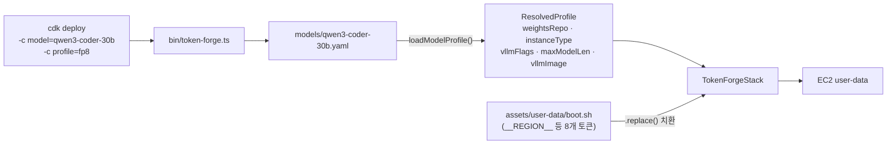
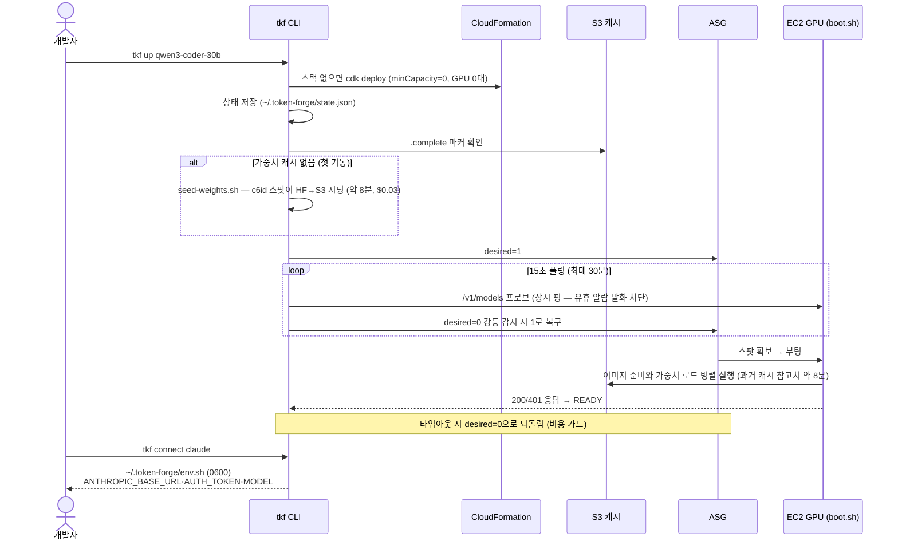
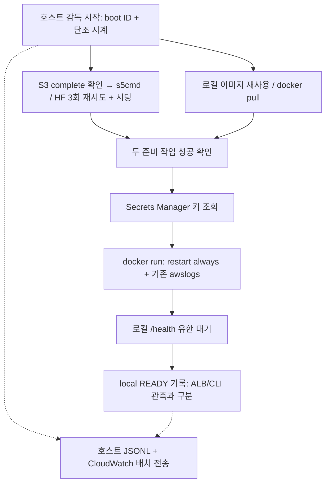
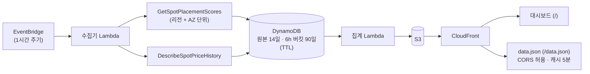
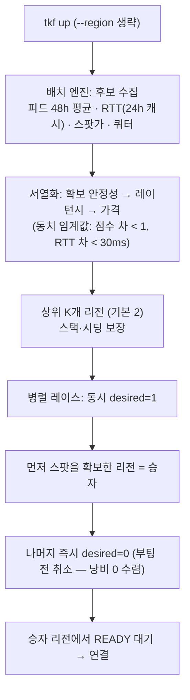

# token-forge 아키텍처 안내

> 프로젝트에 처음 참가하는 사람을 위한 문서. "무엇이 어디서 돌고, 코드가 어떻게
> 연결되는가"를 다이어그램 중심으로 설명한다. 제품이 *왜* 이렇게 생겼는지는
> [PR/FAQ](prfaq.md)와 [v1 요건 정의](superpowers/specs/2026-08-22-token-forge-v1-requirements.md)를 먼저 읽으면 좋다.

## 1. 한 문장 요약

**token-forge는 사용자의 AWS 계정 안에 오픈 웨이트 LLM을 100% 스팟 인스턴스로
띄우고, Claude Code 같은 코딩 에이전트를 바로 연결해 주는 셀프서브 CLI + CDK 스택**이다.
roboco는 서버를 운영하지 않는다 — 유일한 외부 서비스는 "어느 리전에서 스팟이
잡히는가"를 알려주는 공개 배치점수 피드(읽기 전용)뿐이다.

## 2. 큰 그림 — 무엇이 어디서 도는가

```mermaid
flowchart TB
    subgraph LOCAL["개발자 로컬"]
        CC["Claude Code / OpenAI 호환 도구"]
        TF["tkf CLI  (cli/)"]
    end

    subgraph USER["사용자 AWS 계정  ← 추론·데이터는 전부 여기"]
        CF["CloudFront (HTTPS)<br/>allowedCidrs 허용목록(옵션)"]
        ALB["ALB (X-Origin-Verify 검증, 그 외 403)"]
        ASG["ASG min1/max1<br/>100% 스팟 · capacity-optimized<br/>멀티 AZ · 다중 인스턴스 타입"]
        EC2["EC2 GPU 인스턴스<br/>DLAMI + Docker(vLLM)"]
        S3[("S3 가중치 캐시<br/>(Retain)")]
        SM["Secrets Manager<br/>(API 키)"]
        IDLE["유휴 감시 Lambda<br/>30분 무요청 → desired 0"]
    end

    subgraph ROBOCO["roboco 계정 (공개 서비스)"]
        COL["수집기 Lambda (1시간 주기)<br/>GetSpotPlacementScores + 스팟 가격"]
        DDB[("DynamoDB<br/>TTL 90일")]
        CDN["CloudFront<br/>대시보드 + data.json"]
    end

    HF["Hugging Face<br/>(가중치 다운로드)"]

    CC -- "ANTHROPIC_BASE_URL<br/>= 스택 엔드포인트" --> CF
    CF --> ALB
    TF -- "AWS API<br/>(CFN·ASG·EC2·S3·Secrets)" --> USER
    TF -. "익명 GET (선택)<br/>배치점수 추이" .-> CDN
    ALB --> ASG --> EC2
    EC2 <-- "캐시 로드 / 시딩" --> S3
    SM -.-> EC2
    IDLE -.-> ASG
    S3 <-. "선시딩 (최초 1회)" .- HF
    COL --> DDB --> CDN
```

핵심 경계: **프롬프트·응답·사용량 통계는 사용자 계정을 떠나지 않는다**(요건 R2).
외부 통신은 ① HF 가중치 다운로드 ② AWS API ③ 공개 피드 익명 GET, 세 가지가 전부다.
피드 조회조차 차단하려면 같은 수집기를 자기 계정에 띄우는 프라이버시 모드
(`cdk deploy -c collector=1`)가 있다.

## 3. 코드 지도 — 리포 구조

```
bin/token-forge.ts        # CDK 앱 진입점: 컨텍스트(-c model/profile)로 스택 선택·합성
lib/
  token-forge-stack.ts    # 서빙 스택 (ALB·ASG·EC2·S3·Secrets·유휴 Lambda·SNS)
  spot-score-collector-stack.ts  # 배치점수 수집기 스택 (-c collector=1 게이트)
  model-profile.ts        # models/*.yaml 파서 → ResolvedProfile
  naming.ts               # stackNameFor(model, profile) — CFN 제약 정규화
models/<model>.yaml       # 모델 카탈로그: vllmImage + 프로파일별 가중치·인스턴스·플래그
assets/user-data/boot.sh  # EC2 부팅 스크립트 (플레이스홀더 치환 후 user-data로 주입)
scripts/
  seed-weights.sh         # 저가 CPU 스팟으로 HF → S3 선시딩
  start.sh / stop.sh      # desired 1/0 수동 토글
  smoke-test.sh           # /v1/models + /v1/chat/completions 검증
cli/
  tkf.ts                  # 실행 진입점 (bin: tkf)
  program.ts              # commander 커맨드 정의 + 헬퍼 (probe, execInherit 등)
  commands/               # up / down / status / connect (+ 2단계: placement, race)
  aws.ts                  # AWS SDK 래퍼 (AwsApi) — 테스트는 aws-sdk-client-mock
  state.ts                # ~/.token-forge/state.json (마지막 up 대상)
  catalog.ts              # models/ 디렉토리 → 카탈로그 목록
test/                     # jest + ts-jest 단위 테스트
docs/                     # 스펙·계획·가이드 (superpowers/specs, superpowers/plans)
```

설계 원칙: `cli/commands/*`의 로직은 **순수 함수 + 의존성 주입**으로 작성해
AWS 호출·시계·파일시스템을 전부 테스트에서 주입한다. 실제 배선은 `program.ts`에서만 한다.

## 4. 합성(synth) 데이터 흐름 — 모델 yaml이 스택이 되기까지



**가장 깨지기 쉬운 계약**: boot.sh의 플레이스홀더 토큰을 추가·변경하면 세 곳을
동시에 고쳐야 한다 — ① `assets/user-data/boot.sh` ② `lib/token-forge-stack.ts`의
치환 체인 ③ `test/boot-script.test.ts`·`test/token-forge-stack.test.ts`의
PLACEHOLDERS 목록. 하나라도 빠지면 테스트가 막아 준다.

`instanceType`은 콤마 구분 다중 후보를 허용한다("g6e.12xlarge,g6e.24xlarge") —
첫 타입이 Launch Template 기본이 되고, 전체가 ASG MixedInstancesPolicy의
overrides가 되어 **리전 안에서 타입·AZ 차원의 확보 레이스를 ASG가 알아서 수행**한다.

## 5. 기동 시퀀스 — `tkf up`에서 Claude Code 연결까지



비용 가드가 곳곳에 박혀 있는 이유: 이 프로젝트가 다루는 GPU는 시간당 $2.6(g6e.12xlarge)
에서 $30-50(p5.48xlarge)까지 나간다. 그래서 ① 스택 생성과 GPU 기동을 분리하고
(`minCapacity=0`), ② 시딩은 저가 CPU 스팟이 하고, ③ 유휴 30분이면 Lambda가 자동
정지하고, ④ `tkf up` 타임아웃·실패 경로마다 desired를 0으로 되돌린다.

## 6. EC2 부팅 내부 — boot.sh



운영 교훈이 코드에 새겨진 곳들:
- **EP 규칙**: 블록/그룹 양자화 MoE 모델 + 텐서 병렬(TP)은 `--enable-expert-parallel`
  필수 — 없으면 양자화 블록이 깨져 CUDA 그래프 캡처에서 크래시한다(실측 2회).
  새 모델 온보딩 시 기본 점검 항목.
- **ELB 헬스체크 유예 60분**: 대형 모델 콜드 부팅이 헬스체크에 죽지 않도록.
- vLLM 로그는 CloudWatch Logs `/token-forge/vllm`에 보존된다(인스턴스 종료 후에도).
- **전송 보안(R11)**: 사용자 구간은 CloudFront TLS, ALB는 오리진 헤더 게이트로 우회 차단, `tkf rotate-key`로 키 회전(재기동 시 적용).

## 7. 스팟 인텔리전스 — 수집기와 공개 피드



- 배치점수(SPS)는 AWS가 주는 1-10 확보 가능성 선행 지표. 단일 타입 조회는 저평가
  경향이 있어 **절대값보다 추이·리전 간 비교**로 읽는다.
- 스키마와 이용법은 [spot-feed.md](spot-feed.md). 수집 대상 타입·리전은
  `lib/spot-score-collector-stack.ts` 상단 상수가 기준.

## 8. 다음 단계 — 배치 엔진과 병렬 레이스 (R10, 구현 중)

지금까지는 사용자가 리전을 골랐다. 2단계에서는 `tkf up`이 리전을 자동으로 고른다:



배치점수는 확률 신호라 예측이 빗나간다(실측: 같은 리전이 같은 날 33초 확보 ↔ 30분
고갈). 그래서 **예측(후보 선정)과 헤지(병렬 레이스)를 분리**한 것이 이 설계의 핵심이다.
상세는 [v1 요건의 R10 절](superpowers/specs/2026-08-22-token-forge-v1-requirements.md)과
[2단계 구현 계획](superpowers/plans/2026-08-23-tf-cli-phase2-placement.md) 참고.

## 9. 개발 워크플로

```bash
npm test                                   # 전체 테스트 (jest + ts-jest)
npx jest test/model-profile.test.ts        # 파일 단위
npm run build                              # tsc 타입 체크
npx cdk synth -c model=solar-open2-250b -c profile=int4 --quiet   # 합성 확인
```

- CDK 단위 테스트 환경의 AZ는 `dummy1a`/`dummy1b`로 합성된다 — AZ 관련 테스트는
  실제 AZ 이름을 쓰지 않는다.
- 스테일 컴파일 산출물(`*.js`/`*.d.ts`, gitignored)이 ts-jest에서 `.ts`를 가릴 수
  있다 — 테스트가 설명 불가하게 실패하면 먼저 삭제.
- 코드 변경은 브랜치 → PR → CodeSolar 리뷰 Green(오탐은 근거 반박)까지 대응 후 머지.
- 커밋 메시지·문서는 한국어.

## 부팅 계측 계약 (#45)

`__BOOT_LOG_GROUP__`를 포함한 8개 placeholder를 CDK와 양쪽 PLACEHOLDERS 테스트에서 함께 관리한다.
스택별 `/token-forge/<stack>/boot` 로그 그룹은 7일 보존, 스택 삭제 시 Retain이며 출력은
`BootLogGroupName`이다. 기존 `/token-forge/*` 쓰기 IAM을 재사용한다. 새 CW Agent는 설치하지 않는다.
Docker 로그 `/token-forge/vllm`와 구조화된 부팅 이벤트는 별개다.

호스트 `/var/log/token-forge/events.jsonl`은 v1 JSONL이다. `boot_id`(실행별 UUID), `seq`,
`timestamp_ms`(UTC epoch ms), `elapsed_ms`(감독 시작 기준 monotonic), `phase`, `status`,
선택적 `duration_ms`/`cache`/정수 `exit_code`를 기록한다. 단계는 boot/weights/image/container/health/upload,
상태는 start/complete/failed/cancelled/timeout/ready/cache다. 임의 명령 출력·인자·키·토큰·본문은 저장하지 않는다.
`upload` 상태는 `stream: "telemetry"`와 독립 seq를 가진 호스트 전용 이벤트다. core 큐/순번에 포함하지 않는다.
보고서는 core 순번 누락을 검사하고 telemetry는 전송 실패 집계에만 사용한다.
실행마다 별도 boot ID를 만들며 호스트 파일은 append한다. 장기 생존 호스트는 운영자가 파일 회전 정책을 적용한다.

준비 작업은 별도 프로세스 그룹으로 실행한다. 한쪽 실패나 SIGINT/SIGTERM 시 그룹 전체에 TERM/KILL을
보내고 직접 자식을 기다린다. 그룹을 탈출한 프로세스와 Docker daemon 내부 다운로드 취소까지 보장하지 않는다.
supervisor 자체의 SIGKILL/OOM은 finally를 실행하지 않으므로 자손 정리를 보장하지 않는다.
`docker pull` 클라이언트를 종료해도 daemon 측 전송이 잠시 남을 수 있다.
컨테이너 실행 이후 실패 시 컨테이너를 강제 정지하지 않으며 READY는 보고하지 않는다. 기존 CLI/유휴 비용 가드는 유지한다.
전체 호스트 기동 상한은 1,800초, health 단계는 최대 1,200초이면서 전체 상한 이내다.
CLI의 기본 전체 대기 30분에는 별도 준비/스팟 대기 등이 들어가므로 호스트보다 먼저 만료될 수 있다.

전송 스레드는 약 5초마다 작은 배치를 timestamp로 정렬한다. 호출당 4초 상한, 배치당 최대 2회 시도,
종료 시 18초 drain 기한이 지나면 새 호출을 금지하고 현재 전송 프로세스 그룹을 강제 종료한 뒤 스레드를 회수한다.
남은 호출은 4초 timeout 이내이며 무한 재시도하지 않는다. sequenceToken은 사용하지 않는다. HTTP 200 부분 거부도 upload failed다.
실패 배치는 무한 재시도하지 않으며 호스트 파일이 재수집 원본이다. 전송 상태는 호스트에만 기록하며 자기 자신을 재전송하지 않는다.
CreateLogStream 재시도의 ResourceAlreadyExistsException만 기존 스트림 재사용으로 처리한다. READY를 먼저 기록하므로 전송이 추론 시작을
막지 않는다. 즉시 종료·SIGKILL·호스트 유실 시 마지막 이벤트가 유실될 수 있다.

`tkf boot-report --file`은 JSONL과 `aws logs filter-log-events` JSON을 로컬에서 처리한다.
로컬 로그 쓰기 실패는 `TKF_LOCAL_LOG_WRITE_FAILED` 고정 진단을 stderr로 내고 메모리 큐/원격 전송/기동을 계속한다.
이 경우 호스트 원본이 없을 수 있으며 원격 전송도 실패하면 stdout 외에 복구 가능한 기록이 없을 수 있다.

순서가 뒤섞인 이벤트는 seq로 정렬하고 동일 중복은 제거한다. 충돌/누락/미지원/시간 이상은 완전성 문제로 표시한다.
벽시계 역행 또는 단조 시계와 2ms(반올림 허용치) 초과 불일치가 있으면 비용을 산출하지 않는다.
동시 단계 duration은 합산하지 않는다. `--json`에도 비용 가정과 제외 구간을 포함한다.
단가와 단일 boot의 유효 EC2 LaunchTime이 모두 있을 때만 launch→local READY의 고정 단가 근사 비용을 계산한다.
호스트 시작→READY는 부분 관측이며 실제 청구·serving·idle tail·종료 전파·전체 세션 비용 분석이 아니다.

수집·보고·serial/parallel A-B 절차는 README의 부팅 계측 절을 따른다. 이전 격리 GPU 실측은 아래 보고서에 기록했다. 실제 청구액은 검증하지 않았다. 최종 소스 변경은 로컬 회귀 검증만 했으며 과거 약 8분은 현재 소스의 실측값이 아니다.

근거: [PutLogEvents 배치·부분 거부](https://docs.aws.amazon.com/AmazonCloudWatchLogs/latest/APIReference/API_PutLogEvents.html),
[Docker pull 동시 전송](https://docs.docker.com/reference/cli/docker/image/pull/),
[EC2 Instance launchTime](https://docs.aws.amazon.com/AWSEC2/latest/APIReference/API_Instance.html).

루트 볼륨은 gp3 200 GiB / 3,000 IOPS / 500 MiB/s다. 이미지 준비 중 관측된 125 MiB/s 처리량 병목에 대한 최소 변경이다. Ohio 추가 처리량 375 MiB/s 비용은 상시 약 $15/월($0.04/MiB/s-month), 임시 볼륨은 시간 비례다. 기존 스택은 명시적 `cdk deploy` 후 새 인스턴스부터 적용된다. 단축 효과는 환경별 실측으로 확인하며 모델·컴파일·CUDA graph 설정은 변경하지 않는다. [Ohio 실측과 한계](superpowers/plans/2026-10-31-boot-throughput.md)를 참고한다.

선택한 부팅 경로는 리전별 SSM GPU DLAMI, 이미지·가중치 병렬 준비, 위 루트 설정이다. Ohio 2c g6e.12xlarge Spot에서 Qwen3-Coder-30B FP8, vLLM 0.27.1, TP4/EP/131072, S3 가중치 hit·이미지 pull 조건으로 launch→로컬 READY **288.210초**를 1회 관측했다. 이전 125 MiB/s 실행은 477.441초였고, 병렬화만의 serial 대비 차이는 6.186초였다. 서로 다른 시점의 단일 실행이므로 보편적 단축을 보장하지 않는다. AOT cache가 실제 재사용된 prepared AMI는 617.075초로 느려 제품 부팅 경로에서 제외했다. 현재 소스에는 API 키 인자 전달·인자 로그 수정도 포함되며, 이는 로컬 회귀 테스트로 검증했고 새 라이브 벤치마크는 하지 않았다. [실험 결과와 한계](superpowers/plans/2026-10-31-prebootstrap.md)를 참고한다.
일반 boot.sh는 실험용 cache helper를 조회하거나 archive를 가져오거나 vLLM cache를 bind mount하지 않는다. 실험 도구는 수동 재현용으로만 보존한다. API 키는 `--api-key=값`으로 전달하며 인자를 기록하는 logger만 WARNING으로 제한하고 compile INFO는 유지한다.
